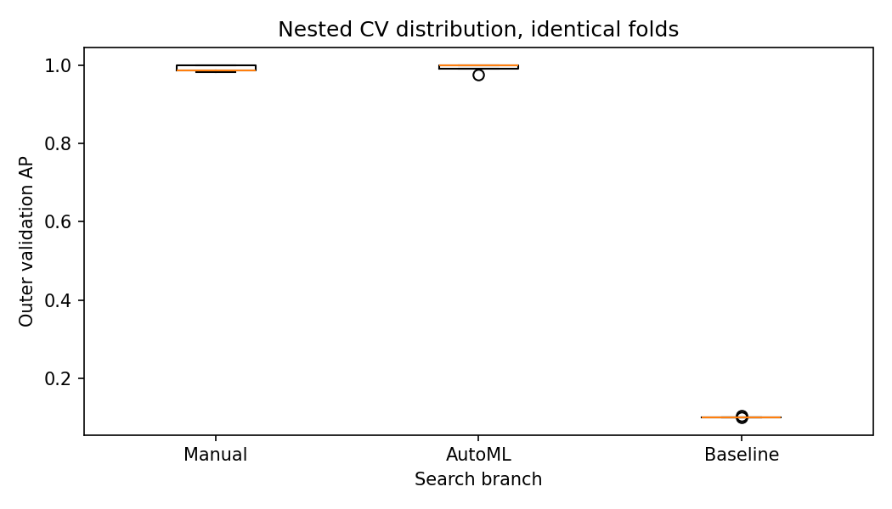
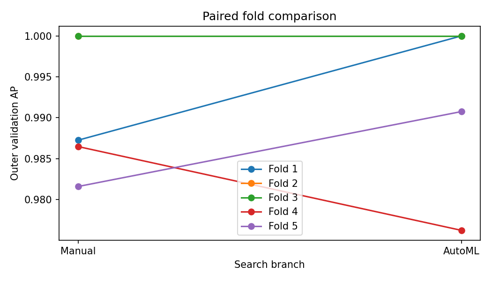
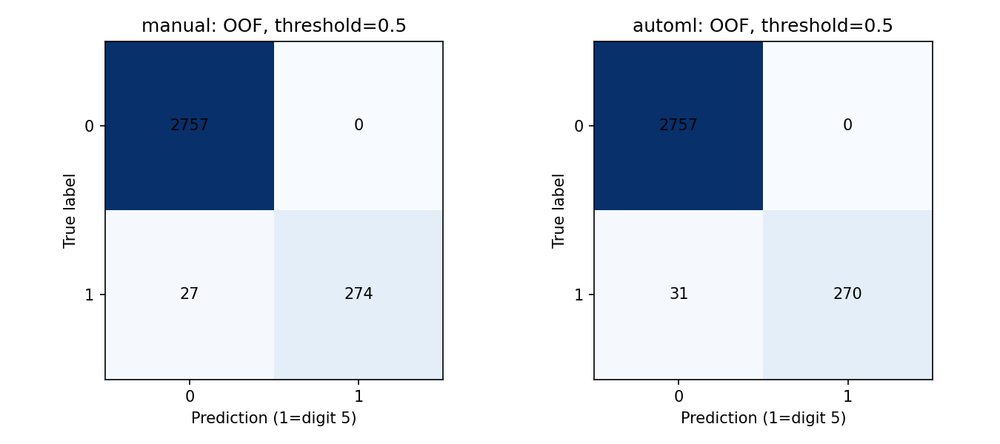
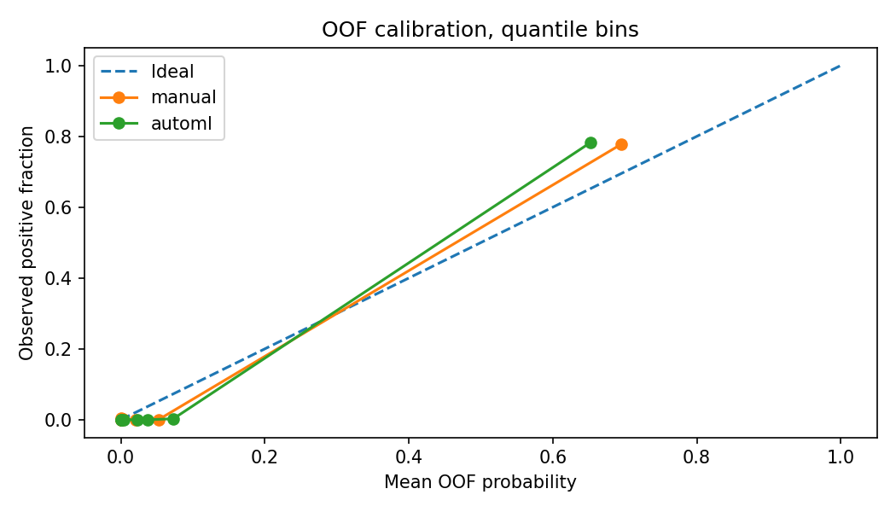
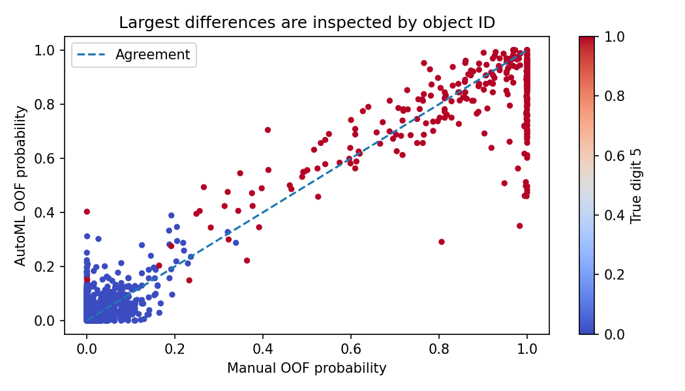
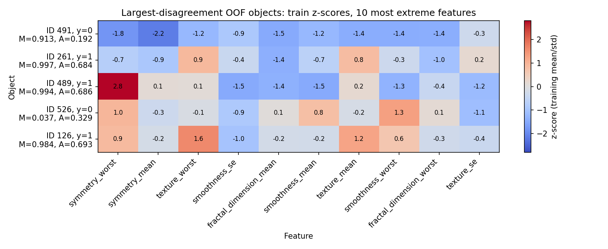
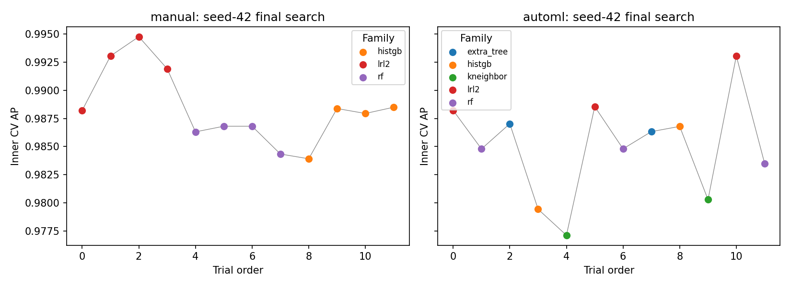
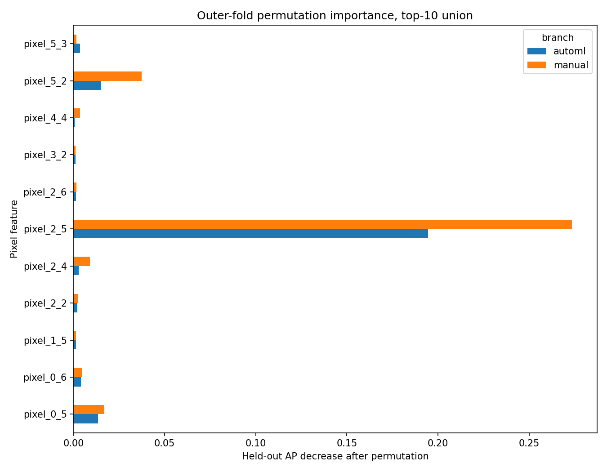

# Лабораторна робота № 6 — AutoML і ручне моделювання: контрольоване порівняння

**Ковальчук · ІПЗс-24-1 · варіант 5 · викладач Бедратюк Л.П.**

Перша частина мініпроєкту ЛР № 6–8. Задача: **malignant проти benign** на Breast Cancer Wisconsin (Diagnostic),
`sklearn.datasets.load_breast_cancer`; позитивний клас y=1 — malignant. Готовий notebook: [`notebook/lab06.ipynb`](notebook/lab06.ipynb).
Журнал аудиту допомоги ШІ: [`AI_USAGE.md`](AI_USAGE.md). Пакет передачі до ЛР № 7: [`handoff/`](handoff/), model card — [`handoff/MODEL_CARD.md`](handoff/MODEL_CARD.md).

## 1. Тема, мета та прикладна постановка

Мета — порівняти **дві процедури пошуку** (ручний перелік конфігурацій і готовий AutoML FLAML) за однакових folds, preprocessing,
метрики, бюджету й ресурсів; зафіксувати інженерний вибір до відкриття test та передати відтворювану модель до ЛР № 7.

Користувач — експерт або оператор лабораторії, який переглядає записи тонкоголкової аспірації (FNA). Один об'єкт — запис із 30 числових
характеристик клітинних ядер. Результат — **ймовірність класу malignant і ранжування записів для ручного розгляду**.
Це навчальний прототип: він **не є діагностичним інструментом**, клінічне використання, скринінг, тріаж пацієнтів і будь-які автоматичні
значущі рішення без експерта заборонені.

## 2. Дані

**Вибір набору.** Методичка ЛР № 6 (файл методички `завд/LR_6_2026.pdf`, зберігається поза репозиторієм; п. 4.1) не містить таблиці варіантів і вимагає лише табличний
набір класифікації, придатний для ЛР № 7–8. Для наступності з варіантом 5 (у таблиці варіантів ЛР № 1 йому відповідає Breast Cancer Wisconsin)
та з ЛР № 5, ПР № 5–6 обрано саме його. Чесні застереження: цей самий набір використовує демонстраційний приклад методички
(з іншим split і seeds) і він уже траплявся в попередніх роботах курсу, тому test незалежний **лише в межах цього експерименту**.
Простір пошуку, метрика, ε і tie-break зафіксовані в [`configs/experiment.json`](configs/experiment.json) до цього запуску й не підбиралися за результатами
попередніх робіт.

**Джерело.** [UCI Breast Cancer Wisconsin (Diagnostic)](https://archive.ics.uci.edu/dataset/17/breast+cancer+wisconsin+diagnostic),
W. Wolberg, W. Street, O. Mangasarian; ліцензія CC BY 4.0 (із посиланням на авторів). Доступ — вбудований `load_breast_cancer`, окремий файл не потрібен
(див. [`data/README.md`](data/README.md)). Назви ознак приведено до конвенції ЛР № 5 (`radius_mean`, `radius_se`, `radius_worst`, …).

| Характеристика | Значення |
|---|---|
| Записів / ознак | 569 / 30, усі числові й невід'ємні |
| Класи (весь набір) | 212 malignant (y=1) / 357 benign |
| Train / test | 455 / 114 |
| Malignant у train / test | 170 (37.4%) / 42 (36.8%) |
| Пропуски, сталі ознаки, дублікати рядків | 0, 0, 0 |
| Діапазон train-ознак | від 0.0 до 4254.0 (різні шкали, тому потрібен scaler) |
| ID | нульовий номер рядка в `load_breast_cancer` |
| Split | stratified 20%, `random_state=42`; IDs у [`results/split_ids.csv`](results/split_ids.csv) |
| SHA-256 сирих даних | `25e2eb7b7a8745b1bde5ba18bc4969983d2e2f403291ecd5bde4a29ef30c3859` |

Хеш обчислено від байтів матриці ознак і цільового вектора `load_breast_cancer` (визначення — у [`data_provenance.json`](results/data_provenance.json)).
EDA обмежено train ([`train_eda.json`](results/train_eda.json)); test не використовувався ні для пошуку, ні для EDA.

**Повторне використання набору.** За ID-перетином зі split ЛР № 5 (читалися лише ID, не ознаки й моделі) із 114 test-записів ЛР № 6 у train ЛР № 5 було 90,
у test ЛР № 5 — 24. Тобто test цієї роботи не є «чистим» щодо попередніх робіт курсу; це зафіксовано в рішенні як обмеження.

**Історія замінюваної версії.** Попередня версія лабораторної (UCI Optdigits, цифра 5 проти решти) була підготовлена в OpenAI Codex і мала реальну помилку протоколу:
API smoke-test FLAML на перших 600 рядках `sklearn.load_digits` передував split і зачепив 111 майбутніх test-ID; її виправляли переходом на `optdigits.tra`.
Нинішня версія замінює той набір повністю, його метрики й висновки сюди не переносяться; зміст помилки й commits — в [`AI_USAGE.md`](AI_USAGE.md).
Через цей досвід у цій версії код перевіряли лише на синтетичних даних (unit-тести з `make_classification`), а `run_experiment.py` на реальних даних виконано один раз.

## 3. План експерименту, метрики та правило рішення

Вкладена CV: **5 outer × 3 inner**, `StratifiedKFold(shuffle=True, random_state=42)`. На кожному outer-train обидві гілки отримують одні й ті самі
inner-індекси; переможець гілки вибирається за середнім inner AP, перевчається на outer-train і оцінюється один раз на відповідній outer-validation (по 91 запису).
OOF: кожен train-ID отримує рівно один відкладений прогноз від кожної гілки й від `DummyClassifier(strategy='prior')`.

**Основна метрика — Average Precision**: $AP=\sum_n (R_n-R_{n-1})\,P_n$ за впорядкованим списком записів; вона залежить лише від порядку оцінок, не від порога,
і вимірює, наскільки високо ранжовані malignant-записи — саме це потрібно для черги ручного розгляду. Для випадкового ранжування AP дорівнює частці позитивних
(у baseline 0.3736 = 170/455). Частка позитивних тут близько 37%, тож ROC-AUC також був би припустимим; його подано як додаткову метрику.
Додаткові: ROC-AUC, F1, precision, recall, balanced accuracy, Brier, log loss. Порогові метрики мають фіксований поріг 0.5, заданий до запуску.

**Правило рішення**, задане до запуску. Нехай $d_j=AP_{AutoML,j}-AP_{Manual,j}$ для outer-fold $j$, $\bar d$ — середнє п'яти різниць, **ε = 0.01 AP**.
Якщо $\bar d>\varepsilon$ — обрати AutoML; якщо $\bar d<-\varepsilon$ — Manual; інакше послідовно: менший серіалізований Pipeline,
менший p95 single-object latency, потім Manual. Перебування в зоні ε не доводить статистичну еквівалентність.

## 4. Preprocessing і простори пошуку

Обидві гілки: `SimpleImputer(median, keep_empty_features=True) → StandardScaler → estimator`; imputer і scaler навчаються **всередині кожного inner fit**.
Власні адаптери-`BaseEstimator` обгортають sklearn Pipeline, щоб FLAML не робив preprocessing до inner split; `FrozenCV` повертає точні збережені індекси.

**Manual — 12 наперед заданих конфігурацій** (усі оцінюються на тих самих inner folds; це перелік, а не випадковий пошук):

| Сімейство | Конфігурації |
|---|---|
| LogisticRegression (L2) | C ∈ {0.01, 0.1, 1, 10}, `max_iter=5000` |
| RandomForest | 64 дерева; (max_depth, min_samples_leaf): (5,1), (10,1), (None,1), (None,3) |
| HistGradientBoosting | (learning_rate, max_iter, max_leaf_nodes): (0.03,100,7), (0.1,100,7), (0.1,100,15), (0.1,150,31); `early_stopping=False` |

**AutoML — FLAML 2.3.6**, готовий CFO, не власна генерація. Параметри: `max_iter=12`, `metric='ap'`, `eval_method='cv'`, `learner_selector='roundrobin'`, `log_type='all'`,
`sample=False`, `auto_augment=False`, `ensemble=False`, `skip_transform=True`, `retrain_full=True`, `n_jobs=1`, `early_stop=False`.
Сімейства й дискретні домени (перше значення — `init_value`; повна копія — [`search_contract.json`](results/search_contract.json)):

| Сімейство | Домени |
|---|---|
| lrl2 | C ∈ {0.01, 0.1, 1, 10}; class_weight ∈ {None, balanced} |
| rf, extra_tree | n_estimators ∈ {32, 64, 128}; max_depth ∈ {5, 10, None}; min_samples_leaf ∈ {1, 3, 5} |
| histgb | max_iter ∈ {50, 100, 150}; learning_rate ∈ {0.03, 0.1, 0.2}; max_leaf_nodes ∈ {7, 15, 31} |
| kneighbor | n_neighbors ∈ {3, 5, 9, 15}; weights ∈ {uniform, distance} |

Простори перекриваються не повністю: Manual не має ExtraTrees, kNN і `class_weight`; AutoML за 12 trials не обов'язково торкається кожної точки (див. розділ 7).
Невдалий trial, нечислова втрата або неповний бюджет зупиняють запуск, а не зникають із таблиці.

## 5. Бюджет і ресурси

Порівняння кандидатів має однаковий бюджет: **12 кандидатів × 3 inner folds = 36 CV-fit на пошук** для кожної гілки (таблиця — з [`budget_audit.csv`](results/budget_audit.csv), секунди з округленням):

| stage | CV-fits (обидві гілки) | Manual, с | AutoML, с | framework refits AutoML |
|---|---|---|---|---|
| outer_0 | 36 | 2.982 | 1.290 | 1 |
| outer_1 | 36 | 3.108 | 1.418 | 1 |
| outer_2 | 36 | 2.911 | 1.209 | 1 |
| outer_3 | 36 | 2.769 | 1.138 | 1 |
| outer_4 | 36 | 2.857 | 1.336 | 1 |
| final_seed_42 | 36 | 3.233 | 1.429 | 1 |
| final_seed_43 | 36 | 3.246 | 1.598 | 1 |
| final_seed_44 | 36 | 3.981 | 1.656 | 1 |
| **Разом (8 пошуків)** | 288 | **25.085** | **11.074** | 8 |

FLAML додатково виконує один внутрішній refit; після нього наш контур однаково перевчає переможця кожної гілки. Отже, бюджет порівняння кандидатів рівний,
а загальна кількість fit має прозору різницю: Manual 37, AutoML 38 на пошук. За вісім пошуків — по 96 кандидатів і 288 CV-fit на гілку; у FLAML ще 8 framework refits,
разом 296 перевірених викликів адаптера ([`flaml_fit_audit.csv`](results/flaml_fit_audit.csv): у кожному `scaler_n == n`). Уся історія — 192 кандидати
([`candidate_history.csv`](results/candidate_history.csv)); сирі JSONL лежать у [`results/logs/`](results/logs/).

**Час не є однаковим бюджетом** і не нормується. AutoML виконав пошуки швидше (11.07 с проти 25.08 с), але це не доводить, що метод швидший у загальному випадку.
За [`candidate_history.csv`](results/candidate_history.csv), середній час trial у Manual: RandomForest 0.369 с, HistGB 0.390 с, LogisticRegression 0.025 с;
у AutoML: RandomForest 0.199 с, HistGB 0.187 с, ExtraTrees 0.134 с, kNN 0.020 с, LogisticRegression 0.025 с. Простіше кажучи, 8 із 12 ручних конфігурацій —
важчі ансамблі (64 дерева, до 150 ітерацій), а пошук AutoML стартує з менших значень (32 дерева, 50 ітерацій) і розподіляє trials між п'ятьма сімействами (у пошуку seed 42:
lrl2 — 3, rf — 3, extra_tree — 2, histgb — 2, kneighbor — 2). Різниця часу відображає склад простору й початкові точки, а не лише метод.

Усі оцінювачі й permutation importance мають `n_jobs=1`; BLAS/OpenMP обмежено `threadpool_limits(1)`. Модельні `random_state=42`; для перевірки стійкості пошуку
seeds splitter/HPO — 42, 43, 44. Середовище — [`environment.json`](results/environment.json): Python 3.12.0, scikit-learn 1.9.0, numpy 2.2.3, pandas 3.0.5, scipy 1.15.3, FLAML 2.3.6.

## 6. Зовнішня якість і парне порівняння

Середнє ± вибіркове стандартне відхилення (ddof=1) п'яти outer-оцінок ([`cv_summary.csv`](results/cv_summary.csv)); std — не довірчий інтервал.

| branch | AP | ROC-AUC | F1 | recall | precision | Brier | log loss |
|---|---|---|---|---|---|---|---|
| AutoML | 0.9942 ± 0.0058 | 0.9949 ± 0.0063 | 0.9603 ± 0.0244 | 0.9353 ± 0.0483 | 0.9886 ± 0.0256 | 0.0250 ± 0.0062 | 0.1011 ± 0.0244 |
| Manual | 0.9922 ± 0.0044 | 0.9938 ± 0.0045 | 0.9544 ± 0.0247 | 0.9294 ± 0.0446 | 0.9821 ± 0.0260 | 0.0260 ± 0.0097 | 0.0993 ± 0.0254 |
| Baseline (prior) | 0.3736 ± 0.0000 | 0.5000 ± 0.0000 | 0.0000 | 0.0000 | 0.0000 | 0.2340 | 0.6609 |

Нульові F1/precision/recall baseline — наслідок `zero_division=0`: prior-класифікатор за порога 0.5 нікого не відносить до malignant.

AP за outer-folds ([`fold_metrics.csv`](results/fold_metrics.csv)):

| fold | Manual | AutoML | Baseline | d_j = AutoML − Manual |
|---|---|---|---|---|
| 0 | 0.9919 | 0.9954 | 0.3736 | 0.0035 |
| 1 | 0.9984 | 0.9984 | 0.3736 | 0.0000 |
| 2 | 0.9886 | 0.9984 | 0.3736 | 0.0098 |
| 3 | 0.9875 | 0.9843 | 0.3736 | −0.0033 |
| 4 | 0.9944 | 0.9944 | 0.3736 | 0.0000 |



**Рисунок 1.** Обидві процедури мають outer AP понад 0.98 на всіх folds і значно перевищують prior baseline 0.3736 (окрема права шкала).
Боксплоти п'яти значень перекриваються; AutoML має вищу медіану, але одне нижче значення (fold 3, 0.9843), тож кращою «за розподілом» гілку назвати не можна.



**Рисунок 2.** Лінії — парні значення AP на одному fold (у легенді нумерація з 1: «Fold 1» = fold 0 у таблицях). На двох folds різниця нульова, на двох — на користь AutoML,
на одному (fold 3) — на користь Manual. Найбільша різниця 0.0098 (fold 2) близька до ε, проте не перевищує його; у цьому fold переможці гілок були різних сімейств (розділ 7).

**Парне порівняння.** Середня різниця $\bar d$ = **0.0020** (точно 0.001999), 95% percentile bootstrap середнього — **[−0.0013; 0.0060]**
(10000 перевибірок із п'яти різниць, seed=42; [`paired_comparison.json`](results/paired_comparison.json)). $|\bar d|<\varepsilon=0.01$, інтервал містить 0 і повністю лежить усередині $[-\varepsilon,\varepsilon]$,
жодна окрема $|d_j|$ не перевищує ε. Це описовий bootstrap п'яти залежних folds, а не незалежний інтервал для популяційної різниці й не доказ еквівалентності.

## 7. Стійкість пошуку й поведінка OOF

Фінальні пошуки на всьому train із різними seeds splitter/FLAML ([`search_stability.csv`](results/search_stability.csv)):

| seed | branch | family | inner_ap | params |
|---|---|---|---|---|
| 42 | manual | lrl2 | 0.9948 | {"C": 1.0} |
| 42 | automl | lrl2 | 0.9930 | {"C": 0.1, "class_weight": null} |
| 43 | manual | lrl2 | 0.9936 | {"C": 1.0} |
| 43 | automl | lrl2 | 0.9934 | {"C": 0.1, "class_weight": "balanced"} |
| 44 | manual | lrl2 | 0.9935 | {"C": 1.0} |
| 44 | automl | lrl2 | 0.9936 | {"C": 0.1, "class_weight": "balanced"} |

**Обидві гілки вибрали `lrl2` для всіх трьох seeds.** Manual щоразу обирає C=1.0; AutoML — C=0.1, змінюється лише `class_weight` (null для seed 42, balanced для 43 і 44).
Seed 42 наперед визначено операційним; 43 і 44 не використовуються для перевибору після test. Для outer-folds переможці ([`outer_winners.json`](results/outer_winners.json)):

| fold | Manual | AutoML |
|---|---|---|
| 0 | lrl2, C=1.0 | lrl2, C=0.1 |
| 1 | lrl2, C=0.1 | lrl2, C=0.1 |
| 2 | HistGB (lr 0.1, 100 iter, 7 leaves) | lrl2, C=0.1 |
| 3 | lrl2, C=1.0 | lrl2, C=0.1 |
| 4 | lrl2, C=0.1 | lrl2, C=0.1 |

AutoML вибирає ту саму конфігурацію в усіх п'яти folds, Manual — lrl2 у чотирьох і HistGB в одному. У folds 1 і 4 обидві гілки обрали одну модель, тому їхні OOF-прогнози й метрики збігаються.
Це суперечить висновку попередньої Optdigits-версії про нестійке сімейство AutoML: **на цьому наборі й цьому просторі такої нестійкості не виявлено**; її не можна переносити на інші дані.

Попарні розбіжності **міток** фінальних моделей на всьому train за порога 0.5 ([`seed_disagreement.json`](results/seed_disagreement.json), пари (42,43), (42,44), (43,44)):
Manual — 0, 0, 0; AutoML — 0.0088, 0.0088, 0 (по 4 записи з 455). Це описова, оптимістична оцінка узгодженості fitted-моделей, не оцінка узагальнення.

Категорії OOF-поведінки на порозі 0.5 ([`behavior_summary.csv`](results/behavior_summary.csv)):

| category | n |
|---|---|
| both_correct | 439 |
| both_wrong | 12 |
| only_automl_correct | 3 |
| only_manual_correct | 1 |

Мітки різняться лише у 4 записах із 455; у 12 записах помиляються обидві гілки (10 із них — пропущені malignant).
Це показує, що згода моделей сама по собі не є якістю.



**Рисунок 4.** OOF за порога 0.5: Manual — TN 282, FP 3, FN 12, TP 158; AutoML — TN 283, FP 2, FN 11, TP 159. Різниця — по одному запису в кожній клітинці помилок
(усього 15 проти 13 помилок із 455), тобто незначна. Найбільший внесок у помилки дають пропущені malignant (11–12 зі 170); для задачі з ціною пропуску
це головний ризик, а AP цього не відображає. Поріг після перегляду результатів не змінювався.



**Рисунок 3.** Quantile-bins (8 груп по ~57 записів) на OOF: обидві кривих близькі до діагоналі, але ймовірності зосереджені біля 0 і 1, тож у діапазоні приблизно 0.2–0.7 груп немає
і середина кривої оцінена грубо. У групі з середнім прогнозом ≈0.79 (Manual) і ≈0.73 (AutoML) спостережена частка malignant — 0.86 і 0.88, тобто там моделі трохи занижують ймовірність.
Середні Brier за folds (0.0250 для AutoML проти 0.0260 для Manual) різняться набагато менше за їхній розкид (0.0062 і 0.0097), тому калібрування практично однакове.



**Рисунок 6.** Більшість точок лежить на діагоналі (у folds 1 і 4 вона точна). Помітні відхилення — malignant-записи (червоні), де Manual дає ≈1, а AutoML — 0.65–0.9: AutoML менш упевнена,
що узгоджується зі сильнішою регуляризацією (C=0.1 проти C=1.0 у folds 0 і 3), хоча окремо це не перевірялося. Розбіжність понад 0.2 мають 17 записів із 455 (за [`oof_behavior.csv`](results/oof_behavior.csv)), понад 0.5 — один.

П'ять найбільших розбіжностей ймовірностей ([`largest_disagreements.csv`](results/largest_disagreements.csv)):

| id | y | fold | manual | automl | category | probability_gap |
|---|---|---|---|---|---|---|
| 491 | 0 | 2 | 0.9131 | 0.1917 | only_automl_correct | 0.7213 |
| 261 | 1 | 2 | 0.9965 | 0.6839 | both_correct | 0.3126 |
| 489 | 1 | 2 | 0.9945 | 0.6857 | both_correct | 0.3088 |
| 526 | 0 | 2 | 0.0366 | 0.3290 | both_correct | 0.2924 |
| 126 | 1 | 2 | 0.9840 | 0.6934 | both_correct | 0.2906 |



**Рисунок 7.** Усі п'ять записів належать до fold 2, де Manual обирав HistGradientBoosting, а AutoML — логістичну регресію: розбіжність, найімовірніше, відображає різні сімейства в цьому fold, а не шум одного сімейства.
Лише запис 491 (benign) дає хибну тривогу Manual за порога 0.5 (0.9131). Усі показані z-score цього запису відносно train від −2.2 до −0.3 (тобто нижчі за середнє),
але рисунок не пояснює, чому дерево дало високу ймовірність, і причини приписувати немає підстав; в інших чотирьох записах обидві моделі за порогом правильні.



**Рисунок 8.** Історія inner AP у фінальному пошуку seed 42. У Manual найкращий кандидат — lrl2 з C=1.0 (0.9948), у AutoML — lrl2 з C=0.1 (0.9930); конфігурацію C=1.0 AutoML за 12 trials не спробував.
Найкращий lrl2 вищий за найкращих представників інших сімейств в обох гілках, але inner AP обчислено на тих самих folds, що й добір, тому вона оптимістична, і за нею **не можна перевибирати модель
чи порівнювати гілки**: порівняння гілок — тільки за outer CV. У фінальному пошуку seed 42 inner AP вищий у Manual (0.9948 проти 0.9930), а за outer CV середнє AP AutoML на 0.0020 більше; це різні процедури на різних даних.

## 8. Permutation importance на outer-validation

Падіння AP після перестановки ознаки (середнє по 5 outer-folds × 5 повторів, `random_state=42`, лише відкладені дані; [`permutation_importance.csv`](results/permutation_importance.csv)).
Для Manual це усереднення п'яти переможців folds, серед яких HistGB у fold 2. Top-10 кожної гілки:

| № | Manual: ознака | падіння | AutoML: ознака | падіння |
|---|---|---|---|---|
| 1 | texture_worst | 0.008267 | texture_worst | 0.006762 |
| 2 | perimeter_worst | 0.004042 | texture_mean | 0.003156 |
| 3 | area_se | 0.003542 | radius_se | 0.003121 |
| 4 | radius_se | 0.002827 | symmetry_worst | 0.002382 |
| 5 | symmetry_worst | 0.002814 | radius_worst | 0.002228 |
| 6 | texture_mean | 0.002441 | area_se | 0.002021 |
| 7 | concave_points_mean | 0.001955 | area_worst | 0.001933 |
| 8 | concavity_worst | 0.001746 | smoothness_worst | 0.001700 |
| 9 | compactness_se | 0.001734 | compactness_se | 0.001672 |
| 10 | concave_points_worst | 0.001690 | radius_mean | 0.001623 |



**Рисунок 5.** Top-10 списки мають Jaccard **0.4286**: перетин 6 (area_se, compactness_se, radius_se, symmetry_worst, texture_mean, texture_worst), об'єднання 14.
Єдина узгоджена вершина — texture_worst; решта абсолютних падінь не перевищує 0.0041 AP, а в позиціях 6–10 значення кожної гілки відрізняються менш ніж на 0.001, тож порядок нижчих позицій ненадійний.
Лише в top-10 Manual: perimeter_worst, concavity_worst, concave_points_mean, concave_points_worst; лише в top-10 AutoML: radius_worst, area_worst, smoothness_worst, radius_mean. Геометрично пов'язані ознаки (радіус, периметр, площа) ділять важливість між собою.
Це чутливість прогнозу до перестановки, а не причинний вплив і не медичне пояснення.

## 9. Інженерні характеристики та рішення до test

Фінальні моделі (seed 42) серіалізуються як повний sklearn Pipeline (`compress=3`) без обгортки AutoML-пошуку ([`engineering.csv`](results/engineering.csv)):

| branch | кандидат | search, с | fit, с | size, байт | single p50, мс | single p95, мс | batch256 p50, мс | batch256 p95, мс |
|---|---|---|---|---|---|---|---|---|
| Manual | manual_02: lrl2, C=1.0 | 3.233 | 0.010 | 2174 | 0.419 | 2.551 | 0.738 | 1.888 |
| AutoML | automl_seed42_trial10: lrl2, C=0.1, class_weight=None | 1.429 | 0.005 | 2171 | 0.422 | 0.932 | 0.496 | 1.300 |

Пакети 1 і 256, 7 прогрівів, 45 вимірювань `perf_counter_ns`, одне середовище. p50 однаковий (0.419 і 0.422 мс); p95 single (2.551 проти 0.932 мс) обчислено лише з 45 вимірювань,
тож він чутливий до поодиноких викидів, і для двох моделей одного сімейства така різниця, імовірно, відображає шум вимірювання, а не властивість моделі. Одиничне вимірювання не доводить SLA.

**Рішення** ([`decision_record.json`](results/decision_record.json), `test_metrics_present=false`): $\bar d=0.001999$, $|\bar d|\le\varepsilon$, тому спрацював наперед заданий tie-break.
Перший критерій — розмір pipeline: **AutoML (2171 байт) проти Manual (2174 байт), різниця 3 байти**. Обрано **AutoML**: `lrl2`, `C=0.1`, `class_weight=None` (`automl_seed42_trial10`).
Критерій p95 latency, де AutoML теж менша, правило не розглядало, бо рішення ухвалено за розміром.

Чесна інтерпретація: обидва фіналісти — логістична регресія L2, їхня якість еквівалентна, а різниця розміру в 3 байти практично позбавлена змісту; критерій розміру тут вироджений
і фактично вибір довільний. Правило застосовано механічно, **не змінювалось після перегляду результатів** і не означає, що AutoML кращий. Manual (lrl2, C=1.0) був би так само обґрунтованим вибором.

SHA-256 файлу рішення (збігається з [`decision.sha256`](results/decision.sha256)): `62caba19558d196bdefb4b1b459d8d6ba1809f5d1f0aa9b7450401380a5a584c`.
SHA-256 конфігурації, записаний у рішенні: `1887300778b787a9e8001574778f032cbce381050cc85df9bcb8d332e82bcffd`.
У [`run_experiment.py`](run_experiment.py) запис рішення й хешу передує звертанню до `Xall[test_ids]`, після прогнозів хеш перевіряється повторно. Хеш доводить незмінність байтів, а не історичний час створення.

## 10. Фінальний test і пакет передачі до ЛР № 7

Test (114 записів, 42 malignant), вибрана модель AutoML lrl2 C=0.1, поріг 0.5 ([`test_metrics.json`](results/test_metrics.json)):

| Метрика | Значення |
|---|---|
| AP / ROC-AUC | 0.9966 / 0.9977 |
| F1 / recall / precision | 0.9756 / 0.9524 / 1.0000 |
| Balanced accuracy | 0.9762 |
| Brier / log loss | 0.0234 / 0.0948 |
| TN / FP / FN / TP | 72 / 0 / 2 / 40 |

Пропущено два malignant-записи (ID 73 із ймовірністю 0.164 і ID 205 із 0.425).

**Порівняння CV і test.** Outer CV вибраної гілки: AP 0.9942 ± 0.0058, F1 0.9603, recall 0.9353, precision 0.9886, Brier 0.0250. На test усі показники не гірші за CV-середні:
AP 0.9966, F1 0.9756, recall 0.9524, precision 1.0000, Brier 0.0234; різниця в межах розкиду folds. Test малий: один запис змінює recall приблизно на 0.024,
тож це не формальна перевірка відсутності shift. Незалежність test обмежена повторним використанням набору (розділ 2).

**Другий фіналіст — лише аудит.** Manual (manual_02: lrl2, C=1.0) оцінено на test **після** заморожування й хешування рішення; результат у
[`test_audit_other_finalist.json`](results/test_audit_other_finalist.json) (`AUDIT_ONLY: true`) **не використовувався для вибору, підбору чи звітування про вибрану модель**.
Для довідки: AP 0.9943, ROC-AUC 0.9960, F1 0.9512, recall 0.9286, precision 0.9750, Brier 0.0213, log loss 0.0773, TN/FP/FN/TP = 71/1/3/39. Різниця між гілками — кілька записів і не розрізняє їх.

**Пакет [`handoff/`](handoff/)**: `pipeline.joblib` (вибраний Pipeline), `decision_record.json` і `decision.sha256`, `config.json`, `split_ids.csv`, `cv_metrics.csv`, `test_metrics.json`,
`data_provenance.json`, `environment.json`, `data_schema.json` (30 ознак у фіксованому порядку з мінімумами/максимумами train), `inference_example.json`, `inference.py`, `requirements.txt`, `MODEL_CARD.md`.
`inference.py` відхиляє неправильну форму, NaN/inf і від'ємні значення; контрольний тест перевіряє ймовірності після `joblib.load`.
Inference потребує лише sklearn/numpy/joblib; FLAML, LightGBM і XGBoost потрібні для відтворення пошуку (FLAML імпортує їх, навіть якщо вони не входять до сімейств).

## 11. Архітектура, тести, відтворення

| Файл | Роль |
|---|---|
| [`experiment.py`](experiment.py) | завантаження даних, Pipeline, два пошуки, метрики, bootstrap, розбіжності, розмір, latency, хеш |
| [`run_experiment.py`](run_experiment.py) | повний контур: nested CV → стійкість → freeze рішення → test → handoff |
| [`inference.py`](inference.py) | перевірка схеми входу й прогноз |
| [`configs/experiment.json`](configs/experiment.json) | наперед заданий контракт |
| [`tests/test_experiment.py`](tests/test_experiment.py) | 26 тестів (13 функціональних, 13 перевірок артефактів) |
| [`build_notebook.py`](build_notebook.py) | генерація пояснювального notebook через nbformat (лише читає збережені результати) |

Команди з каталогу `lab06/` (Python 3.12):

```bash
python -m venv .venv
# Windows: .venv\Scripts\activate
# Linux/macOS: source .venv/bin/activate
pip install -r requirements.txt
python run_experiment.py
python -m unittest discover -s tests -v
python handoff/inference.py
python build_notebook.py
jupyter nbconvert --to notebook --execute --inplace notebook/lab06.ipynb
```

Якщо kernel `python3` вказує на інший інтерпретатор і notebook не бачить пакетів venv, зареєструйте kernel із venv
(`python -m ipykernel install --user --name lab06`) і додайте `--ExecutePreprocessor.kernel_name=lab06`.

Повторний `run_experiment.py` відтворює таблиці, рисунки й моделі, але знову оцінює test; це відтворення, а не нова незалежна перевірка, і воно перезаписує збережені результати.
Для читання закомічених результатів достатньо notebook: він нічого не навчає й не повторює пошук чи test, а перераховує метрики, bootstrap, категорії OOF, хеш і контрольний інференс зі збережених файлів.
Час і p95 на іншій машині будуть іншими; метрики детерміновані за фіксованого середовища.

Тести перевіряють: математику метрик і поріг, bootstrap, `FrozenCV` (незмінність індексів), fold-local scaler, пошук на синтетичних даних, схему serving, заборону прапорців
`test_used_for_search/selection` (`check_test_flags`), OOF без пропусків, фактичну кількість fit у бюджеті, історію trials, вкладеність ID, цілісність рішення й хешу, відтворення
правила вибору, перерахунок AP і test-метрик, інференс зі збереженої моделі, джерело даних, поля рішення, наявність рисунків і порядок ознак у схемі.
Під час експерименту попередження перетворюються на помилки; notebook не містить error/stderr outputs.

## 12. Інженерний висновок

Відповіді на вісім питань методички (п. 4.18):

1. **Чи перевершили обидві гілки baseline?** Так. Outer AP: AutoML 0.9942, Manual 0.9922 проти 0.3736 у prior baseline; на кожному з п'яти folds обидві гілки вищі за baseline.
2. **Чи значущою була перевага на практиці?** Ні. Середня різниця AP AutoML − Manual 0.0020 менша за ε=0.01, bootstrap-інтервал [−0.0013; 0.0060] містить 0, жодна окрема різниця не перевищує ε.
   Якість практично еквівалентна; це наслідок прийнятого правила, а не доведена еквівалентність (п'ять залежних folds).
3. **Наскільки стійким був пошук?** Обидві гілки вибрали lrl2 для трьох seeds (Manual — C=1.0; AutoML — C=0.1, `class_weight` змінюється). Розбіжність міток між фінальними моделями: Manual 0,
   AutoML до 0.0088 (4 записи з 455). Серед outer-folds AutoML завжди обирав ту саму конфігурацію, Manual — lrl2 у чотирьох і HistGB в одному. Стійкість — властивість цього набору й простору, не загальний висновок.
4. **Де моделі розходилися в прогнозах і важливості?** Мітки різняться у 4 записах із 455, у 12 помиляються обидві. Найбільша розбіжність ймовірності — запис 491 (0.9131 проти 0.1917); усі п'ять найбільших розбіжностей — у fold 2,
   де сімейства переможців різні. У важливості Jaccard top-10 лише 0.4286 (перетин 6 із 14); узгоджено лише texture_worst, абсолютні падіння AP малі, нижчі позиції ненадійні; причинності немає.
5. **Яка ціна якості за часом, розміром і latency?** Видимої ціни якості немає. Пошуки: Manual 25.08 с, AutoML 11.07 с (8 пошуків; різницю значною мірою пояснюють склад простору й початкові точки).
   Розмір pipeline 2174 проти 2171 байт; single p50 ≈ 0.42 мс в обох, p95 2.55 проти 0.93 мс (імовірно шум одного вимірювання; правило до latency не дійшло). У масштабі цієї задачі усі відмінності практично незначні.
6. **Яку модель заморожено до test і чому?** AutoML, lrl2, C=0.1, `class_weight=None` (`automl_seed42_trial10`). Різниця AP в межах ε, тому за наперед заданим правилом вирішив менший розмір (2171 проти 2174 байт, 3 байти).
   Вибір практично довільний: обидва фіналісти — одне сімейство з еквівалентною якістю; правило не змінювалось після результатів. Хеш рішення 62caba19…584c записано до відкриття test.
7. **Чи узгодився test із очікуваннями?** Так: AP 0.9966, F1 0.9756, recall 0.9524, precision 1.0, матриця 72/0/2/40 — не гірше за CV (AP 0.9942 ± 0.0058). Другий фіналіст (лише аудит) дав AP 0.9943 і 4 помилки проти 2.
   Test малий (114 записів, 42 malignant) і не є повністю «чистим» щодо попередніх робіт курсу, тому це підтвердження обережне.
8. **Які обмеження передано в ЛР № 7?** Одне джерело з 569 записів, без інформації про пацієнтів чи час (залежність між записами не виключена); перенесення на інші лабораторії й сканери не перевірене;
   набір уже використовувався в курсі (90 і 24 test-ID збігаються з train/test ЛР № 5); фіксований поріг 0.5 при 11–12 пропущених malignant із 170 в OOF і 2 із 42 на test — поріг і калібрування
   потребують окремої валідації й не повинні підбиратися на поточному test; малий бюджет пошуку (12 trials); ненадійний ранг важливості; вироджений tie-break за розміром (для наступного циклу варто наперед
   задати мінімальну відносну різницю розміру, нижче якої критерій вважається нерозрізняльним); модель навчальна, діагностичне й клінічне використання заборонено.
