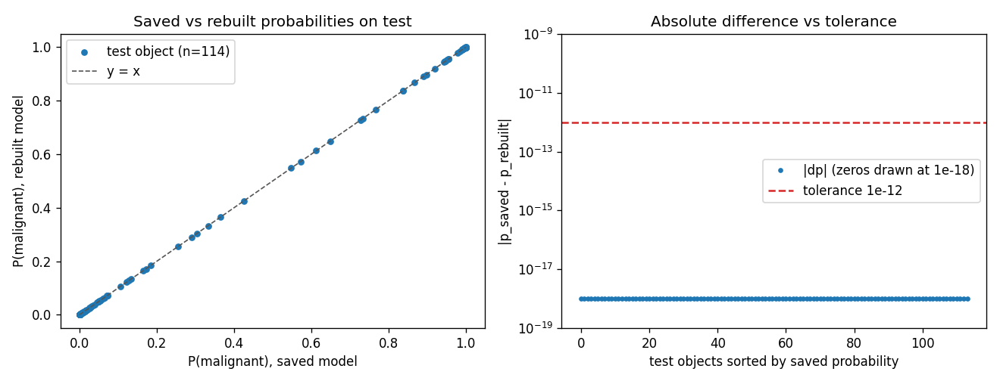
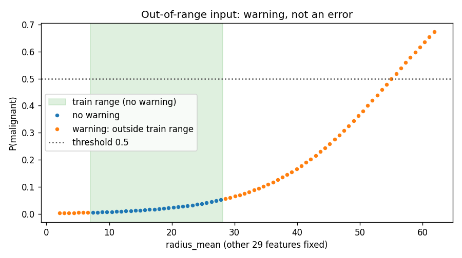

# Лабораторна робота № 7 — Відтворювана структура ML-проєкту: конфігурація, тестування та пакування моделі

**Ковальчук · група ІПЗс-24-1 · варіант 5 · викладач Бедратюк Л.П.**

Друга частина мініпроєкту ЛР № 6–8. Задача та дані ті самі, що в [ЛР № 6](../lab06/): **malignant проти benign** на Breast Cancer Wisconsin (Diagnostic),
позитивний клас y = 1 — malignant. Тут заморожена модель ЛР № 6 стає програмним компонентом. Готовий notebook: [`notebook/lab07.ipynb`](notebook/lab07.ipynb).
Журнал аудиту допомоги ШІ: [`AI_USAGE.md`](AI_USAGE.md). Model card: [`reports/model_card.md`](reports/model_card.md).
Навчальний прототип: **не діагностичний інструмент**, клінічне використання заборонено.

## 1. Приймання handoff ЛР № 6

Вхід — [`../lab06/handoff/`](../lab06/handoff/) (стан ЛР № 6 на commit `81445e2`). Перевірку виконує `build_artifacts.py`; результат — [`reports/handoff_acceptance.json`](reports/handoff_acceptance.json).

| Що вимагає методичка | Стан | Примітка |
|---|---|---|
| Модель | є (`pipeline.joblib`) | чистий sklearn `Pipeline`; байти збігаються з `lab06/results/models/automl.joblib` |
| Decision JSON + хеш | є | `decision.sha256` дорівнює SHA-256 байтів `decision_record.json` (`62caba19…584c`); збігається з `test_metrics.json` |
| Конфігурація | є | `config.json`; `config_sha256` у рішенні збігається з її хешем |
| Схема | є | `data_schema.json`: 30 ознак, порядок, min/max; **min/max збігаються з train-частиною, не з усім набором** |
| Split IDs | є | 455 train / 114 test, унікальні, покривають 0…568 |
| Контрольний приклад | є, але **позиційний** | 3 масиви без імен ознак; перетворено на іменовані записи |
| Метрики test | є | AP 0.9965986394557824, матриця [[72, 0], [2, 40]]; positive_n = 42 перераховано з ID — збігається |
| Model card, залежності, середовище, походження даних | є | `MODEL_CARD.md`, `requirements.txt`, `environment.json`, `data_provenance.json` |
| **Контрольна сума моделі** | **відсутня** | handoff хешує лише decision record, не `pipeline.joblib` |
| Фіксовані параметри оцінювача (`max_iter`, `random_state`) | **відсутні в рішенні** | є лише в коді ЛР № 6 (`build_pipeline`); звірено з `get_params()` переданої моделі: `max_iter=5000`, `random_state=42` |
| `requirements.txt` | **надлишковий** | вимагає flaml, xgboost, lightgbm, jupyter, які inference не потребує; замінено мінімальним файлом |

**Рішення щодо прогалини.** Хеш моделі не «відновлювався з пам'яті». Модель прийнято за незалежними доказами: (1) SHA-256 `b63381332edb446557779d0d3042cd4e3be973cbc9fd70a1682513fe9abc315b`
однаковий у `handoff/pipeline.joblib` і `lab06/results/models/automl.joblib`; (2) передана модель відтворює контрольні ймовірності з `inference_example.json` (макс. |Δp| = 0.0);
(3) rebuild за frozen-рішенням дає ті самі ймовірності (розділ 8). Протиріч між файлами не знайдено: розбіжність «ознаки min/max ≠ min/max усього набору» — свідомо train-діапазон.
Цей хеш записано в `models/model_metadata.json` уже в ЛР № 7, тож відтепер модель має контрольну суму; відповідальність за вибір моделі лишається за ЛР № 6.

## 2. Межі змін

Model selection **завершено** в ЛР № 6. Дозволено: структура коду, перевірки, документація, пакування. Заборонено на підставі test: змінювати family (`lrl2`), параметри (`C=0.1`, `class_weight=None`),
поріг (0.5), ознаки чи preprocessing. У проєкті немає `GridSearchCV`, FLAML чи іншого оптимізатора; тест `test_no_search_machinery_is_used` ловить виклики пошуку й імпорт `flaml`.
Test ID використовуються лише для перерахунку вже відомої метрики AP.

## 3. Структура проєкту

```
lab07/
  configs/    project_config.json, schema.json, frozen_decision.json, inference_example.json
  data/       split_ids.csv                      (заморожені train/test ID)
  models/     pipeline.joblib, model_metadata.json
  reports/    model_card.md, reproducibility.json, handoff_acceptance.json, test_results.txt, clean_run.txt, handoff_verification.json
  src/ml_project/  config.py validation.py predictor.py train.py cli.py  (+ errors.py, integrity.py)
  tests/      test_config, test_validation, test_predictor, test_cli, test_rebuild, test_artifacts
  build_artifacts.py  package_handoff.py  build_notebook.py  pyproject.toml  requirements.txt  project_manifest.json
  notebook/lab07.ipynb  figures/
```

`src/` містить лише повторно використовувану логіку; notebook її лише викликає. `errors.py` (винятки з кодами виходу) та `integrity.py` (`sha256_file`, перевірка manifest, строгий JSON) додано окремо від п'яти файлів з методички,
щоб `config`, `predictor` і `cli` не імпортували один одного по колу. `.gitattributes` (`* -text`) зберігає байти хешованих файлів на Windows і Linux.

## 4. Конфігурація

[`configs/project_config.json`](configs/project_config.json) → незмінний `ProjectConfig` (frozen dataclass; шляхи — `MappingProxyType`). Поля: версії (config/model/schema), класи, `threshold`, `max_batch_size`, `random_state`,
`numeric_tolerance`, відносні шляхи. Секретів немає. `load_project_config` блокує: відсутні й невідомі поля, типи (bool не вважається числом), `threshold` поза (0, 1), `max_batch_size` поза [1, 100000],
однакові класи, допуск поза (0, 1e-3], абсолютні шляхи (POSIX і Windows, у т.ч. `C:\`, `\\server`), компоненти `..`, а також шлях, що після `resolve()` виходить за корінь (симлінк). Дубльовані ключі JSON відхиляються (розділ 11).
Корінь проєкту — батьківський каталог `configs/`. Це не пісочниця, лише захист від випадкового виходу за межі проєкту.

**Допуск обрано до запуску порівнянь.** Для ймовірностей |Δp| ≤ **1e-12**, для метрик ≤ 1e-9. Обґрунтування: `LogisticRegression` з детермінованим lbfgs, `n_jobs=1`, те саме середовище — очікується збіг до округлення float64
(ε ≈ 1.1e-16); 1e-12 лишає запас на порядок підсумовування в BLAS, але вужчий за будь-яку змістовну різницю. Чутливість виміряно **після** запуску (допуск не підганявся): зміна C з 0.1 на 0.1001 дає max |Δp| на test 1.5e-4,
вилучення одного train-рядка — 1.4e-2; обидва на 8–10 порядків перевищують допуск. Допуск придатний лише для цього детермінованого випадку; для GPU чи паралельних алгоритмів його потрібно обґрунтовувати окремо.
Типовий `rtol=1e-5` у `np.allclose` для p ≈ 0.5 допускає різницю 5e-6, тобто на шість порядків слабший за обраний допуск, тому його не використано.

## 5. Схема входу

[`configs/schema.json`](configs/schema.json): версія 1.0, 30 ознак у порядку (назва, `float64`, обов'язкова, train min/max), `positive_class`/`negative_class`, `non_negative`, політики (`missing`/`extra` → відхилити, поза діапазоном → попередження).
Порядок ознак збігається з `lab06/handoff/data_schema.json` (тест перевіряє, коли ЛР № 6 поруч). **Блокують** прогноз (`InputValidationError`, код 5): відсутня чи зайва ознака, нечисловий тип
(рядок `"12.3"`, `True`, `null`, список), NaN, ±∞, від'ємне значення, значення, що переповнює масштабування моделі (напр. `smoothness_mean=1e308`, див. розділ 11), batch понад ліміт (`BatchSizeError`, код 6).
**Лише попереджає:** значення поза train min/max — `warnings` у відповіді. Валідатор бере записи за іменами, порядок ключів JSON не впливає.

Цільова мітка: `y = (load_breast_cancer().target == 0)`, тобто **1 = malignant** (sklearn кодує malignant нулем). Це зафіксовано в `schema.json`, `model_metadata.json`, коді rebuild і перевірено тестом
(212 malignant у даних, 42 у test; дзеркальна мітка дає AP, що відрізняється від еталона більш ніж на 0.1).

## 6. Predictor і стабільна відповідь

`ProjectPredictor(config)`: читає метадані й frozen decision, перевіряє SHA-256 схеми, рішення та **моделі до `joblib.load`**, узгоджує версії/клас/поріг між config, схемою й метаданими
(зміна порога в config без нової версії моделі → `ConfigError`), лише потім десеріалізує модель і перевіряє `n_features_in_ = 30`, `classes_ = [0, 1]`.
Методи: `describe()`, `predict_record()`, `predict_batch()`; `sha256_file` — у `integrity.py`, реекспортовано з `predictor.py`.

Відповідь: `probability`, `predicted_class` (`malignant`/`benign` за правилом `probability >= threshold`), `threshold`, `positive_class`, `model_version`, `schema_version`, `warnings`. Без sklearn-об'єктів і шляхів.
Контрольний запис 0: **p = 0.7168759163903421**, `malignant`, 0 попереджень (записи 1 і 2: 0.010616676653026312 та 0.01484657472201454, обидва `benign`).
Одиночний і пакетний виклики узгоджені в межах допуску.

## 7. CLI

Усі команди з кореня `lab07/`. **Windows PowerShell:**

```powershell
python -m venv .venv; .\.venv\Scripts\Activate.ps1
pip install -r requirements.txt
$env:PYTHONPATH = "src"
python build_artifacts.py            # вимагає ../lab06/handoff і pandas (requirements-dev.txt)
python -m unittest discover -s tests -v
python -m ml_project.cli --config configs/project_config.json metadata
python -m ml_project.cli --config configs/project_config.json predict configs/inference_example.json
python -m ml_project.cli --config configs/project_config.json predict-batch configs/inference_example.json
python -m ml_project.cli --config configs/project_config.json validate input.json
python -m ml_project.cli --config configs/project_config.json verify
python -m ml_project.train --project-root . --output rebuilt.joblib
```

**Linux / macOS:**

```bash
python -m venv .venv && source .venv/bin/activate
pip install -r requirements.txt
export PYTHONPATH=src
python build_artifacts.py
python -m unittest discover -s tests -v
python -m ml_project.cli --config configs/project_config.json metadata
python -m ml_project.cli --config configs/project_config.json predict configs/inference_example.json
python -m ml_project.cli --config configs/project_config.json predict-batch input.csv
```

Із `pip install -e .` змінна `PYTHONPATH` не потрібна, з'являється й команда `ml-project`. Вхід: JSON-об'єкт (іменовані ознаки) для `predict`; JSON-список або CSV із заголовком для `predict-batch`
(`configs/inference_example.json` має ключі `record` і `records`). Додано команду `verify` (перевірка manifest). Результат — JSON у stdout; помилки — одним рядком у stderr і ненульовий код:

| Код | Виняток | Приклад |
|---|---|---|
| 0 | — | успіх |
| 1 | непередбачена помилка | резервний шлях, без traceback |
| 2 | помилка використання (argparse) | невідома команда |
| 3 | `ConfigError` | `..` у шляху, невірний поріг, дубльований ключ у config |
| 4 | `InputFileError` | немає файла, невалідний JSON, дубльований ключ JSON |
| 5 | `InputValidationError` | відсутня ознака, NaN, рядок замість числа |
| 6 | `BatchSizeError` | понад `max_batch_size` |
| 7 | `ArtifactIntegrityError` | хеш моделі/схеми/manifest не збігається |
| 8 | `RebuildError` | rebuild відмовився |

## 8. Rebuild і відтворюваність

`rebuild_model(project_root, output_path)` перенавчає ту саму конфігурацію на тих самих 455 train ID (preprocessing, `C=0.1`, `class_weight=None`, `max_iter=5000`, `random_state=42`, y = malignant),
перевіряючи хеші ID, рішення й сирих даних; пише у вказаний файл (до замороженої моделі писати відмовляється) і порівнює з переданою. Дані — з [`reports/reproducibility.json`](reports/reproducibility.json) (запуск `build_artifacts.py`) і з notebook:

| Перевірка | Результат |
|---|---|
| Контрольні ймовірності: передана / rebuilt / очікувана | 0.7168759163903421 / 0.7168759163903421 / 0.7168759163903421 (всі три записи збігаються) |
| max \|Δp\| передана vs rebuilt: контрольні 3 / test 114 / усі 569 | 0.0 / 0.0 / 0.0 (допуск 1e-12) |
| max \|Δ\| коефіцієнтів | 0.0 |
| Test AP: ЛР № 6 / передана / rebuilt | 0.9965986394557824 / 0.9965986394557824 / 0.9965986394557824 (допуск 1e-9) |
| Матриця помилок test | [[72, 0], [2, 40]] = еталон |
| Файли побайтово однакові | **ні** (`8b12baa9…aa17` проти `b6338139…c315b`) |

Збіг **числовий, не побайтовий** (різні pickle-байти за однакових ваг), тому довіра до моделі спирається на хеш переданого файла, а rebuild лише підтверджує, що процедуру можна повторити.
Збіг test AP не означає, що test використовувався для підбору: конфігурація заморожена до відкриття test.



**Рис. 1.** Ліворуч усі 114 test-точок лежать на діагоналі `y = x`; праворуч різниця дорівнює нулю (нулі на логарифмічній осі намальовано як 1e-18) і далеко нижча за допуск 1e-12.
Це підтверджує числову еквівалентність у тому самому середовищі, не загальну стійкість до іншого BLAS чи версії sklearn.



**Рис. 2.** Зі збільшенням `radius_mean` запису 1 (у train-діапазоні P ≈ 0.01) ймовірність плавно зростає і перетинає поріг 0.5 при `radius_mean ≈ 55.8` (train max 28.11, відношення 1.98).
Попередження з'являються рівно поза [6.981; 28.11] (52 з 80 точок сітки; перевірено порівнянням). Це лінійна екстраполяція: попередження сигналізує дрейф, але не доводить, що прогноз хибний чи правильний.

## 9. Metadata і manifest

[`models/model_metadata.json`](models/model_metadata.json): версії моделі й схеми, family `lrl2`, candidate `automl_seed42_trial10`, параметри, SHA-256 моделі, схеми, frozen decision і split IDs,
`raw_x_target_sha256` даних, еталонні test-метрики ЛР № 6, версії Python 3.12.0 / scikit-learn 1.9.0 / numpy 2.2.3 / scipy 1.15.3 / joblib 1.6.0, призначення й обмеження.
[`project_manifest.json`](project_manifest.json): SHA-256 28 файлів — моделі, схеми, конфігурації, `predictor.py` та решти коду, frozen decision, метаданих, звітів, тестів тощо. Він записується **останнім**
кроком `build_artifacts.py` і не покриває себе, README, AI_USAGE, `test_results.txt`, notebook і figures (вказано в самому manifest). `python -m ml_project.cli verify` та тест `test_manifest_matches_files` перевіряють збіг.

## 10. Тести

Запуск: `python -m unittest discover -s tests -v` → **Ran 84 tests, OK** (запис — [`reports/test_results.txt`](reports/test_results.txt)); за групами: config 10, validation 17, predictor + integrity 18, CLI 15, rebuild 12, artifacts/manifest 12.

- **Модульні:** конфігурація (відсутні/невідомі поля, типи, діапазони, `../`, абсолютні шляхи, симлінк), схема (missing/extra, рядок, bool, `None`, NaN, ±∞, від'ємне, надвелике число, out-of-range → warning, межі діапазону, ліміт batch).
- **Інтеграційні й регресійні:** реальна модель із схемою; контрольний прогноз проти очікування з допуском; незалежність від порядку JSON; одиночний vs batch; **checksum до `joblib.load`** — підмінена копія в тимчасовому каталозі
  містить шкідливий pickle (`__reduce__` створив би файл-маркер): виняток `ArtifactIntegrityError`, `joblib.load` не викликано, маркера немає; один змінений байт; змінена схема/рішення; поріг у config ≠ метаданим.
- **CLI (subprocess):** `metadata`, `predict`, `predict-batch` (JSON і CSV), `validate`, `verify`; окремі коди виходу для кожного класу помилок; stdout порожній, а stderr починається з `error[...]` без traceback.
- **Rebuild:** тільки train ID, збіг ймовірностей і AP з допуском, відмова перезаписати frozen-модель, відмова для іншого family, змінений split, відсутність пошуку; перевертання мітки дає відмінний від еталона AP.
- **Артефакти:** хеші метаданих, manifest (виявлення підміни та відсутнього файла), збіг із `lab06/handoff` (пропускається поза репозиторієм), діапазони схеми = train min/max.

Тести перевірено на чутливість: з шести навмисних мутацій реалізації (завантаження моделі до перевірки хеша, значення в порядку запису, out-of-range → помилка, прийняття bool, перевернута мітка, ігнорування зайвих ознак)
кожна ламає відповідний тест (`python mutation_check.py`, результат — [`reports/mutation_check.txt`](reports/mutation_check.txt)). Подробиці — в [`AI_USAGE.md`](AI_USAGE.md).

## 11. Реальні дефекти, знайдені під час перевірки

Перші два пройшли початкові тести й були виявлені перевіркою поведінки, третій — оглядом вмісту архіву; детально — в [`AI_USAGE.md`](AI_USAGE.md).

1. **Дубльований ключ JSON.** `json.loads` мовчки залишає останній дубль: запис із двома `radius_mean` (перший 1000.0) давав код 0 і прогноз без попередження. Виправлено `strict_json_loads`
   (код 4 для входу, 3 для config); тести `test_duplicate_json_keys_are_rejected_not_last_wins`, `test_config_with_duplicate_key_is_rejected` падали на старому коді.
2. **Скінченні, але надвеликі значення.** `smoothness_mean=1e308` проходив валідацію (лише діапазонне попередження), а `StandardScaler` переповнювався: з predictor виходив сирий `ValueError`, CLI давав резервний код 1 і RuntimeWarning у stderr.
   Тепер — `InputValidationError` (код 5); значення 1e6 і далі лише попереджає.
3. **Службові файли в архіві.** Перша версія пакувальника включала `*.egg-info` (41 файл замість 36); тепер їх пропущено, а `junk_entries` перевіряється в `handoff_verification.json`.

## 12. Чистий запуск (завдання 14)

Нове віртуальне середовище **поза репозиторієм**, Python **3.12.0**, лише `pip install -r requirements.txt` і `pip install -e .` (мережа доступна, встановлення пройшло). Встановлено: numpy 2.2.3, scipy 1.15.3, scikit-learn 1.9.0,
joblib 1.6.0, threadpoolctl 3.6.0 та транзитивні cloudpickle 3.1.2 і narwhals 2.28.0 (їх не було в `requirements.txt` ЛР № 6). Без pandas, matplotlib, flaml, xgboost, lightgbm.
Результат ([`reports/clean_run.txt`](reports/clean_run.txt)): `verify` → `manifest_ok`, `predict configs/inference_example.json` → p = 0.7168759163903421, `unittest` → **Ran 84 tests, OK**,
консольна команда `ml-project` працює, `python -m ml_project.train` → `passed: true`. Обмеження: один Python і одна ОС (Windows 11); Linux не перевірявся.

## 13. Model card

[`reports/model_card.md`](reports/model_card.md): призначення й користувач, заборонені застосування, версії й хеші, дані, метрики ЛР № 6 (не змінювалися), контракт входу, умови відтворення, відомі обмеження.

## 14. Handoff до ЛР № 8

`python package_handoff.py` створює `dist/lab07_handoff.zip` (каталог `dist/` у `.gitignore`) з configs, data, models, reports, src, tests, `pyproject.toml`, requirements, manifest, README і скриптів збирання.
Далі архів **розпаковується в новий тимчасовий каталог**, і з розпакованої копії виконуються: імпорт пакета (перевірено, що `ml_project` береться з розпакованої копії, а не з робочого дерева), `verify`,
`predict` контрольного запиту (|Δp| проти очікуваного = 0.0) та `unittest discover` — результат у [`reports/handoff_verification.json`](reports/handoff_verification.json): `passed: true`, 36 файлів,
**Ran 84 tests, OK (skipped=2)**. Два пропущені тести порівнюють файли з `lab06/handoff`, якого немає поруч з розпакованим архівом; у репозиторії вони виконуються (84 без пропусків).
Обмеження: у архів не входять notebook, figures і AI_USAGE.md; файл `handoff_verification.json` описує архів, але сам до нього не входить (інакше це було б циклічно).

## 15. Інженерний висновок

- **Що відтворено.** Модель ЛР № 6 стала компонентом із конфігурацією, схемою, predictor-ом, CLI, manifest і 84 тестами. Rebuild за frozen-рішенням на тих самих 455 train ID без пошуку дав тотожні ймовірності
  (max |Δp| = 0.0 на всіх 569 записах), той самий test AP 0.9965986394557824 і ту саму матрицю помилок. Відтворення числове, не побайтове.
- **Які інваріанти перевіряються.** Хеш моделі, схеми, рішення й ID до використання; цільова мітка (malignant = 1) та склад train/test; порядок ознак незалежно від порядку JSON; узгодженість версій, класу й порога
  між config, схемою та метаданими; допуск 1e-12 для ймовірностей.
- **Які помилки блокуються.** Відсутні/зайві/нечислові/нескінченні/від'ємні/переповнювальні ознаки, дубльовані ключі JSON, надто великий batch, підмінена модель/схема/рішення, `..` і абсолютні шляхи в config, невалідні значення config.
  Out-of-range лише попереджає.
- **Чи збігається контрольний прогноз.** Так: 0.7168759163903421 у переданої, rebuilt і очікуваної версій (|Δp| = 0.0 < 1e-12); також у чистому venv і з розпакованого архіву.
- **Що ще не production-ready.** Немає HTTP-шару, автентифікації, обмеження частоти, журналювання й моніторингу дрейфу; поріг 0.5 не калібровано; pickle довіряється лише за SHA-256 (доводить незмінність, не безпеку); перевірено один Python і Windows;
  дані одного джерела (569 записів); аудиту якості на підгрупах не було. Модель не є діагностичним засобом.
- **Які гарантії передаються до ЛР № 8.** (1) Компонент не завантажить модель, хеш якої не збігається з метаданими; (2) відповідь має фіксовані поля і не містить внутрішніх об'єктів чи шляхів; (3) контракт входу й коди помилок
  стабільні (таблиця в розділі 7), помилки — винятки `ProjectError`; (4) manifest дозволяє перевірити, що отримано той самий код, модель і схему; (5) зміна порога чи версії потребує нової версії моделі. Негарантовано: швидкодія,
  якість поза train-діапазоном, потокобезпечність.
