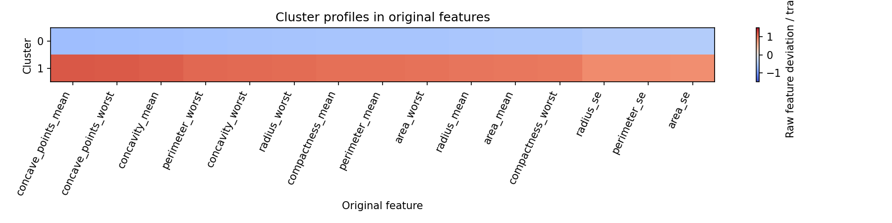
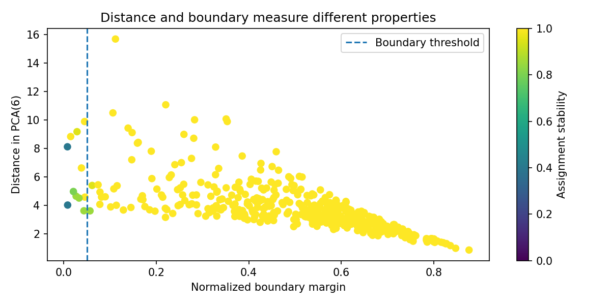
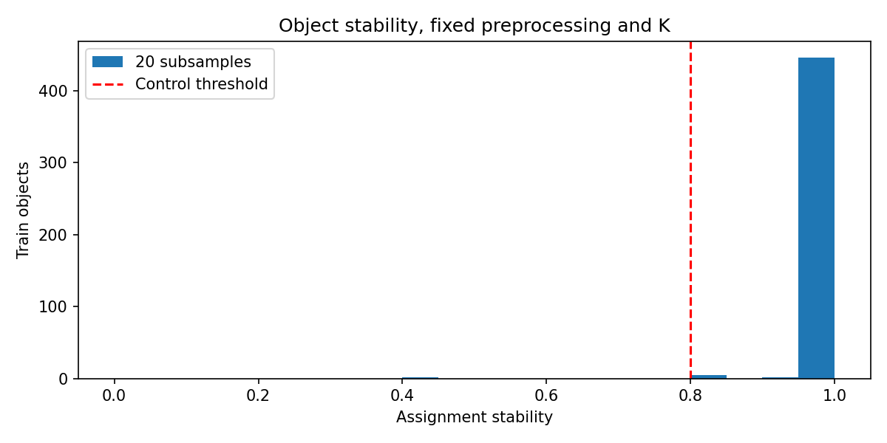
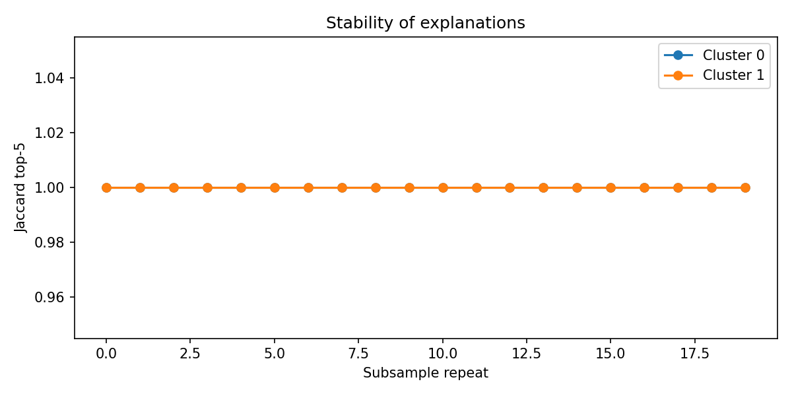
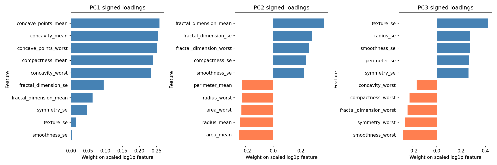
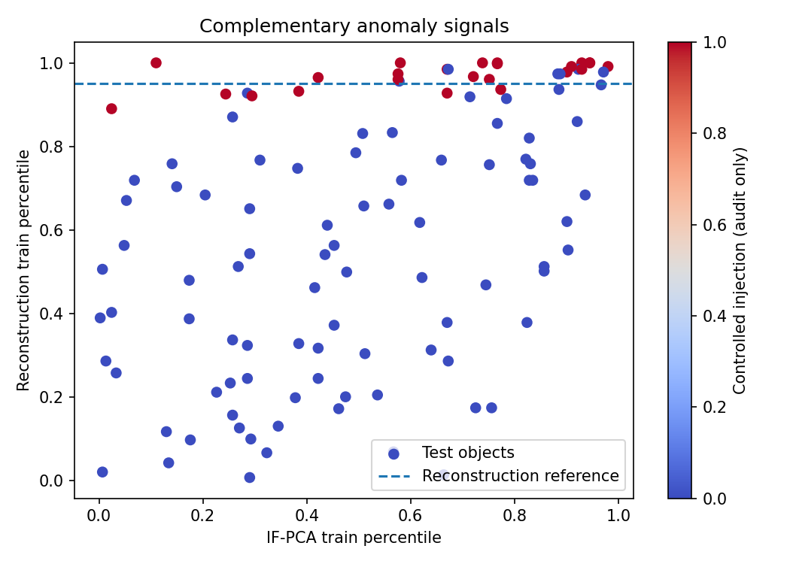
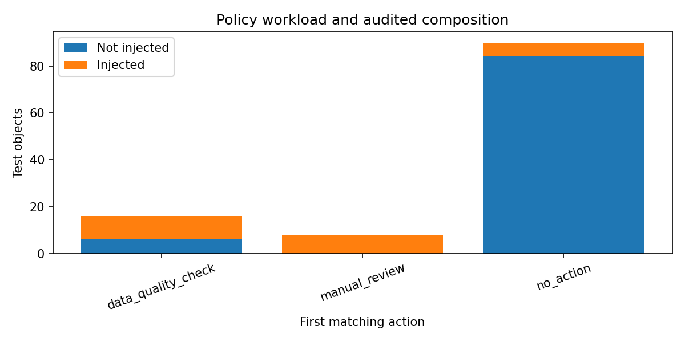

# Практична робота № 6 — Інтерпретація та перевірка корисності результатів навчання без учителя

**Ковальчук · група ІПЗс-24-1 · варіант 5 · викладач Бедратюк Л.П.**

Робота продовжує [ЛР № 5](../lab05/) на **Breast Cancer Wisconsin (Diagnostic)**. Окремої таблиці варіантів у методичці ПР № 6 немає:
вимога — використати зафіксовані артефакти попереднього експерименту. Основні пояснення та всі виводи — у
[`notebook/practical06.ipynb`](notebook/practical06.ipynb), рішення щодо допомоги ШІ — у [`AI_USAGE.md`](AI_USAGE.md).

## 1. Тема, мета та постановка

Мета — перевірити, чи стійкі пояснення кластерів і аномалій та чи підтримують вони обмежене рішення оператора.
Вхід: ознаки, preprocessing, PCA, K-Means і детектори ЛР № 5. Вихід: перевірений контракт, профілі, реальні представники,
стійкість кожного запису, пояснення PCA, структуровані картки та маршрут перевірки якості.
Цільова змінна діагнозу не є входом кластеризації або правил. Високий score не означає медичного висновку.

## 2. Дані та успадкований контракт

569 записів, 30 невід'ємних числових ознак. Train — 455, test — 114; IDs успадковано з ЛР № 5.
Робочі q=6, K=2 не змінюються. Log1p, StandardScaler, PCA та Isolation Forest уже навчені на чистому train.
У test відтворено ті самі контрольовані спотворення ЛР № 5: calibration_scale, geometry_break, worst_mean_swap, texture_noise.
Їхній індикатор відкрито лише для оцінювання наслідків правил, а не для добору порогів.

[`results/validation.json`](results/validation.json) фіксує SHA-256 bundle, конфігурації, split і selected K.
Перевіряються наявність/читаність файлів, схема й типи scores, кінцевість чисел, діапазон процентилів, унікальні IDs,
неперетин частин, форми матриць і допустимі cluster IDs. Пошкоджений JSON та відсутній файл спричиняють помилку.
Джерело ознак — вбудований `sklearn.load_breast_cancer`, назви приведено до конвенції ЛР № 5.

## 3. План і preprocessing аналізу

1. Завантажити та перевірити контракт без нового пошуку q/K.
2. Побудувати профілі **сирих початкових ознак**: $P_{kj}=(\bar x_{kj}-\bar x_j)/s_j$, SD з ddof=0; стала ознака дає 0.
3. Рахувати відстані в робочому PCA-просторі; взяти по три типові, віддалені та граничні записи.
4. Порівняти п'ять seeds і 20 підвибірок по 90% train; PCA й preprocessing лишаються фіксованими.
5. Узгодити номери кластерів за train-перетинами, оцінити S, Jaccard top-5 та числовий дрейф профілів.
6. Перевірити PCA-пояснення крайніми реальними записами; сформувати картки й застосувати зафіксовані правила.
7. Відкрити контрольні мітки спотворень, порахувати FP/FN і прийнятність сценаріїв.

Базовий RNG — 42. Підвибірки різні через послідовні виклики одного RNG(42); кожний новий K-Means має random_state=42.
П'ять seeds успадковано з ЛР № 5 як окрему перевірку впливу ініціалізації. Межа нестійкості — S<0.8, межа boundary — margin<0.05.

## 4. Реалізація та відтворення

| Файл | Відповідальність |
|---|---|
| [`audit.py`](audit.py) | чисті функції контракту, профілів, відстаней, представників, вирівнювання, політики та карток |
| [`pr06_analysis.py`](pr06_analysis.py) | послідовний запуск, збереження CSV/JSON, рисунки |
| [`configs/audit.json`](configs/audit.json) | підвибірки, межі, пріоритет правил, сценарні припущення |
| [`tests/test_audit.py`](tests/test_audit.py) | 20 перевірок, включно з регресійним тестом змісту карток |
| [`build_notebook.py`](build_notebook.py) | генератор пояснювального notebook через nbformat |

Команди з каталогу `practical06/`, Python 3.12, залежності з кореня репозиторію:

```bash
pip install -r ../requirements.txt
# Якщо локального bundle ЛР5 ще немає після clone:
python ../lab05/lr05_experiment.py
python pr06_analysis.py
python -m unittest discover -s tests -v
python build_notebook.py
jupyter nbconvert --to notebook --execute --inplace notebook/practical06.ipynb
```

Bundle `../lab05/artifacts/lr05_bundle.joblib` ігнорується Git, але відтворюється наведеною командою.
Його pickle посилається на `lab05/src/unsupervised_pipeline.py`; запуск додає правильний шлях до імпорту.
У notebook повторно перевіряються збережені результати; важкий аудит виконує `pr06_analysis.py`.

## 5. Профілі, розміри та розсіювання

| cluster | n | fraction | mean_distance | rms_distance | neighbor_cluster | center_distance | mean_stability | unstable_n | boundary_n | jaccard_mean | max_profile_change |
| --- | --- | --- | --- | --- | --- | --- | --- | --- | --- | --- | --- |
| 0 | 303 | 0.6659 | 3.3907 | 3.6647 | 1 | 6.7734 | 0.9931 | 2 | 8 | 1.0000 | 0.0334 |
| 1 | 152 | 0.3341 | 4.3874 | 4.8610 | 0 | 6.7734 | 1.0000 | 0 | 3 | 1.0000 | 0.0703 |

Кластер 0 більший, кластер 1 має більші середні відстані та RMS, тобто ширше розсіювання в PCA.
Їхній єдиний сусід — інший кластер; відстань між центрами 6.7734.
Повний профіль: [`cluster_profiles.csv`](results/cluster_profiles.csv); п'ять відхилень кожного знака —
[`profile_top_signed.csv`](results/profile_top_signed.csv). Якщо відхилень певного знака менше п'яти, не доповнюю їх іншим знаком.

| cluster | direction | feature | profile |
| --- | --- | --- | --- |
| 0 | positive | smoothness_se | 0.0034 |
| 0 | negative | concave_points_mean | -0.5870 |
| 0 | negative | concave_points_worst | -0.5809 |
| 0 | negative | concavity_mean | -0.5678 |
| 0 | negative | perimeter_worst | -0.5397 |
| 0 | negative | concavity_worst | -0.5335 |
| 1 | positive | concave_points_mean | 1.1702 |
| 1 | positive | concave_points_worst | 1.1580 |
| 1 | positive | concavity_mean | 1.1319 |
| 1 | positive | perimeter_worst | 1.0759 |
| 1 | positive | concavity_worst | 1.0635 |
| 1 | negative | smoothness_se | -0.0068 |



**Рисунок 1.** Найсильніше розрізняються показники нерівності контуру і розміру. У кластера 1 вони вищі від середнього train,
у кластера 0 — нижчі. Це відтворюваний числовий опис, але він не дозволяє назвати кластер діагнозом.

## 6. Реальні представники та геометрія

| cluster | kind | id | distance | second_distance | margin |
| --- | --- | --- | --- | --- | --- |
| 0 | typical | 362 | 0.84844 | 6.84476 | 0.87605 |
| 0 | typical | 79 | 0.97020 | 6.34633 | 0.84712 |
| 0 | typical | 74 | 1.15953 | 7.05734 | 0.83570 |
| 0 | distant | 505 | 9.88355 | 10.34831 | 0.04491 |
| 0 | distant | 71 | 9.42381 | 10.94530 | 0.13901 |
| 0 | distant | 176 | 9.17071 | 9.44129 | 0.02866 |
| 0 | boundary | 318 | 8.10869 | 8.17352 | 0.00793 |
| 0 | boundary | 86 | 4.00991 | 4.04359 | 0.00833 |
| 0 | boundary | 207 | 4.96329 | 5.06867 | 0.02079 |
| 1 | typical | 392 | 1.53882 | 7.12048 | 0.78389 |
| 1 | typical | 337 | 1.59069 | 7.38968 | 0.78474 |
| 1 | typical | 432 | 1.81838 | 7.30478 | 0.75107 |
| 1 | distant | 152 | 15.68685 | 17.65926 | 0.11169 |
| 1 | distant | 3 | 11.06293 | 14.19091 | 0.22042 |
| 1 | distant | 68 | 10.49236 | 11.73900 | 0.10620 |
| 1 | boundary | 376 | 8.82758 | 8.96074 | 0.01486 |
| 1 | boundary | 119 | 6.61921 | 6.88215 | 0.03821 |
| 1 | boundary | 81 | 4.56833 | 4.78663 | 0.04561 |

Центроїд є середнім вектором; типовий представник — фактичний запис із найменшою відстанню до нього, а не сам центр.
Той самий ID може входити до різних видів представників: це різні властивості одного запису.
Boundary margin $B=(d_2-d_1)/\max(d_2,\varepsilon)$ відрізняється від абсолютної відстані.



**Рисунок 2.** Малі margin зустрічаються на різних відстанях; граничність не можна замінити пошуком найдальших точок.
Кольором подано стійкість, а вертикаллю — контрольну межу. Представники з ID та всією діагностикою доступні в CSV і notebook.

## 7. Стійкість призначень і профілів

П'ять seeds: ARI=1.0000, мінімальна стійкість=1.00.
Підвибірки: середній попарний ARI=0.9769, середня S=0.995385, мінімум=0.40;
нижче 0.8 — **2 записи**. Базовий запуск не включено до знаменника 20 повторів.

| id | cluster | distance | second_distance | margin | stability |
| --- | --- | --- | --- | --- | --- |
| 318 | 0 | 8.10869 | 8.17352 | 0.00793 | 0.40000 |
| 86 | 0 | 4.00991 | 4.04359 | 0.00833 | 0.40000 |
| 207 | 0 | 4.96329 | 5.06867 | 0.02079 | 0.80000 |
| 39 | 0 | 4.63403 | 4.76094 | 0.02666 | 0.85000 |
| 435 | 0 | 4.50180 | 4.65542 | 0.03300 | 0.85000 |
| 99 | 0 | 3.60827 | 3.77262 | 0.04356 | 0.85000 |
| 255 | 0 | 3.60122 | 3.81756 | 0.05667 | 0.85000 |
| 176 | 0 | 9.17071 | 9.44129 | 0.02866 | 0.95000 |
| 469 | 0 | 5.38953 | 5.74130 | 0.06127 | 0.95000 |
| 376 | 1 | 8.82758 | 8.96074 | 0.01486 | 1.00000 |

ID 318 і 86 мають S=0.4 та margin нижче 0.01. ID 207 із S=0.8 вже не порушує строгу межу.
Решта таблиці — найближчі до нестійких за ранжуванням, а не ще вісім доведених проблемних записів.
Порівняння показує, чому висновок «усі записи надійні, бо ARI високий» відхилено.



**Рисунок 3.** Переважна маса має S=1, проте хвіст включає два нестійкі записи. Середнє маскує цей хвіст.



**Рисунок 4.** Jaccard top-5 в обох кластерах дорівнює 1 у всіх повторах. Числа профілю змінюються:
максимальні зміни 0.033356 і 0.070265 SD.
За числовим дрейфом менш стійкий кластер 1; за складом top-5 відмінностей немає. Конкретні значення й кожен повтор —
[`profile_runs.csv`](results/profile_runs.csv), [`profile_stability.csv`](results/profile_stability.csv).

## 8. Перевірка PCA-пояснень



**Рисунок 5.** PC1 має лише додатні ваги; для неї «найбільших від'ємних» немає, а на графіку також показано найменші додатні.
Її найбільша вага — concave_points_mean (0.25899).
PC2 протиставляє фрактальні характеристики розмірам; PC3 — частину похибок вимірювання частині worst-характеристик.
Ці ваги стосуються log1p + StandardScaler, **не сирих одиниць**. Повна таблиця всіх знаків і крайніх внесків є в notebook.

| PC | side | ID | coordinate | largest contributions |
| --- | --- | --- | --- | --- |
| 1 | max | 108 | 11.93823 | concavity_mean: +0.969; concave_points_mean: +0.861; compactness_mean: +0.747 |
| 1 | min | 175 | -6.33449 | concave_points_worst: -0.451; perimeter_worst: -0.447; perimeter_mean: -0.431 |
| 2 | max | 152 | 12.31746 | fractal_dimension_se: +2.630; concavity_se: +2.103; fractal_dimension_mean: +1.531 |
| 2 | min | 368 | -5.66562 | fractal_dimension_mean: -0.634; area_worst: -0.606; radius_worst: -0.566 |
| 3 | max | 213 | 6.78877 | smoothness_se: +2.074; concave_points_se: +0.890; fractal_dimension_se: +0.596 |
| 3 | min | 379 | -4.76674 | smoothness_worst: -1.013; compactness_worst: -0.828; fractal_dimension_worst: -0.725 |

Перевірка конкретними початковими значеннями:

| PC | feature | raw at min | raw at max | scaled log at min | scaled log at max |
| --- | --- | --- | --- | --- | --- |
| 1 | radius_mean | 8.67100 | 22.27000 | -1.88737 | 2.07491 |
| 2 | fractal_dimension_mean | 0.05054 | 0.09296 | -1.73116 | 4.17711 |
| 3 | texture_se | 1.02700 | 1.66700 | -0.26769 | 0.91737 |

Крайні записи підтримують названі контрасти за наведеними ознаками, але не доводять причинності.
Об'єкт може мати інші протилежні внески: тому збережено всі ознаки, не тільки top-3.
Знак компоненти умовний. Зміна усіх ваг і координат на протилежні зберігає модель; предметне пояснення — саме контраст.
Контрприклад надмірній інтерпретації: висока PC1 не доводить конкретний діагноз, а низька PC1 не виключає його.

## 9. Аномальні сигнали, картки та правила

Процентиль кожного score обчислено за повним відповідним train-розподілом із правилом ≤.
Combined успадковано з ЛР № 5 як max процентилів IF-PCA/reconstruction, а його власний percentile знову калібрується за train combined.
Перцентилі не є оцінками ймовірності аномалії.



**Рисунок 6.** IF-PCA та reconstruction оцінюють різні відхилення; мітка ін'єкції додана лише для зовнішнього аудиту.
Низький IF-PCA не виключає великої похибки відновлення: аномалія може лежати поза PCA-підпростором.

| Пріоритет | Умова | Дія оператора |
|---|---|---|
| 1 | pct_combined ≥ 0.99 | manual_review: переглянути запис та первинне вимірювання |
| 2 | pct_rec ≥ 0.95 | data_quality_check: перевірити ознаку з найбільшим залишком |
| 3 | stability < 0.8 | uncertain_segment: не довіряти сегменту без ручного розгляду |
| інакше | жодної умови | no_action: зберегти без додаткового маршруту |

Усі спрацьовані умови збережено, застосовано першу. Неправильний оператор або нечисловий score зупиняє політику.
15 різних карток: top combined, **фактична незгода прапорців** IF-PCA/rec і FP. Початковий відбір лише за різницею процентилів
був помилковим: чотири з п'яти записів не мали різних прапорців; виправлення та regression test — окремий коміт.

| id | category | cluster | stability | action |
| --- | --- | --- | --- | --- |
| 247 | top_combined | 1 | 1.0000 | manual_review |
| 564 | top_combined | 1 | 1.0000 | manual_review |
| 95 | top_combined | 1 | 1.0000 | manual_review |
| 408 | top_combined | 1 | 1.0000 | manual_review |
| 537 | top_combined | 1 | 1.0000 | manual_review |
| 298 | detector_disagreement | 0 | 1.0000 | manual_review |
| 359 | detector_disagreement | 0 | 1.0000 | data_quality_check |
| 501 | detector_disagreement | 1 | 1.0000 | data_quality_check |
| 519 | detector_disagreement | 1 | 1.0000 | data_quality_check |
| 417 | detector_disagreement | 1 | 1.0000 | data_quality_check |
| 83 | false_positive | 1 | 1.0000 | data_quality_check |
| 288 | false_positive | 0 | 1.0000 | data_quality_check |
| 504 | false_positive | 0 | 0.9500 | data_quality_check |
| 528 | false_positive | 0 | 1.0000 | data_quality_check |
| 568 | false_positive | 0 | 1.0000 | data_quality_check |

Кожна картка містить окремі scores, процентилі, margin, стійкість, усі умови, найбільший залишок ознаки,
перевірювану гіпотезу, дію й межі пояснення. Повні CSV та JSON: [`anomaly_cards.csv`](results/anomaly_cards.csv),
[`anomaly_cards.json`](results/anomaly_cards.json). «Перевірити вимірювання» є гіпотезою, не встановленою причиною.

## 10. Наслідки та два сценарії

| action | n | tp | conflicts | fp | fraction |
| --- | --- | --- | --- | --- | --- |
| data_quality_check | 16 | 10 | 0 | 6 | 0.1404 |
| manual_review | 8 | 8 | 8 | 0 | 0.0702 |
| no_action | 90 | 6 | 0 | 84 | 0.7895 |



**Рисунок 7.** Усього направлено 24 / 114 (21.05%): TP=18, FP=6, FN=6, TN=84.
Precision=0.75, recall=0.75; конфліктів правил — 8. FP означає «без штучної ін'єкції», а не «доброякісний».
Розподіл за діагнозом (лише audit) збережено в [`action_label_audit.csv`](results/action_label_audit.csv).

| Параметр | Перевірка якості, обмежено прийнята | Автоматичне відбракування, відхилене |
|---|---|---|
| Користувач | оператор якості лабораторних вимірювань | автоматичний імпортер записів |
| Вхід / рішення | scores, профіль, залишки → ручна черга | ті самі сигнали → відмова прийняти запис |
| Допустима затримка | 1000 мс після готових вимірювань | 100 мс |
| Бюджет ручного перегляду | ≤30% потоку | ≤10% потоку |
| FP / FN, умовна вартість | 3 / 20 одиниць | 100 / 20 одиниць |
| Фактичне навантаження | 21.05% у бюджеті; 24 × 3 хв = 72 хв | бюджет перевищено; 6 неспотворених записів відкинуто |
| Пояснення користувачеві | percentile, залишок конкретної ознаки, невпевненість сегмента | ті самі числа не доводять причину відмови |
| Зупинка | порушення схеми, дрейф, перевищення бюджету | не запускати автоматичне відбракування |

Вартість 3/20/100 — навчальні припущення, не виміряна економіка. Сценарна сума FP×3+FN×20=138;
для відбракування FP×100+FN×20=720. Окремо: 6 FP забрали б 18 хв із 72 хв перевірок.
Наскрізну затримку не виміряно, тому часові вимоги залишаються відкритими. Стійкість test оцінюється офлайн за ансамблем повторів;
готового онлайн-сервісу для нових записів ця робота не створює.

## 11. Висновки та обмеження

Підтверджено стійкість top-5 профілів, проте відхилено гарантію надійності кожного призначення за високим загальним ARI.
Нестійкі ID 318 і 86 потребують обережної інтерпретації. PCA-пояснення узгоджуються з наведеними крайніми значеннями,
але залишаються описом напрямів, а не причин. Сигнали аномальності доповнюють один одного.

Обмежена користь — офлайнова маршрутизація перевірки якості з людиною. Автоматичні scores, пояснення та черга допустимі;
діагноз, видалення або остаточне відбракування — ні. Штучні чотири типи спотворень не репрезентують усі реальні помилки.
Після зміни приладу, розподілу, схеми або частки направлень потрібна нова незалежна валідація та перекалібрування.
Word/PDF, окремі контрольні питання й матеріали захисту до цього пакета не включено за вказівкою студентки.
