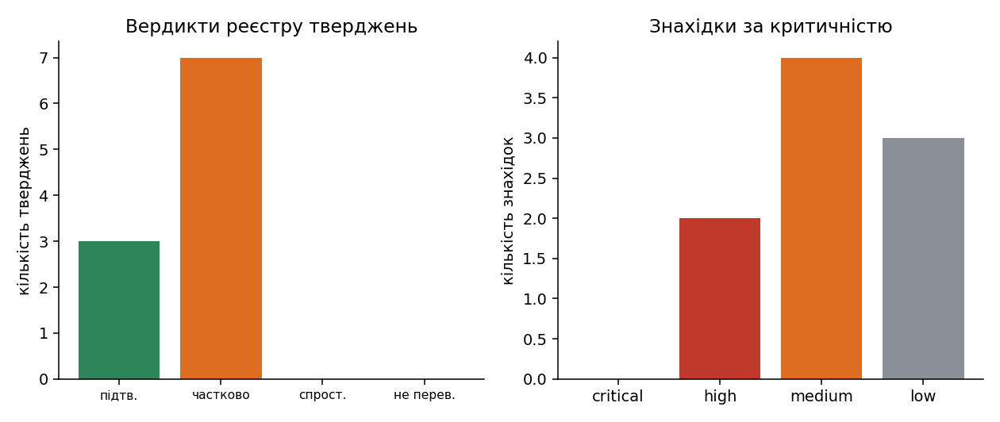
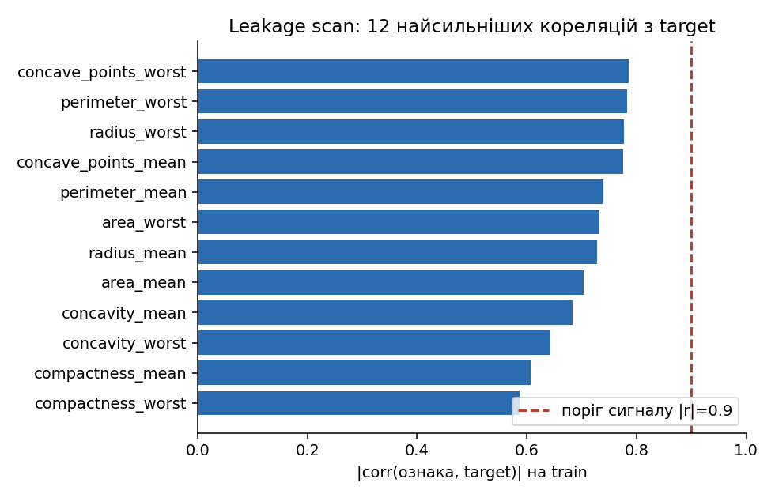
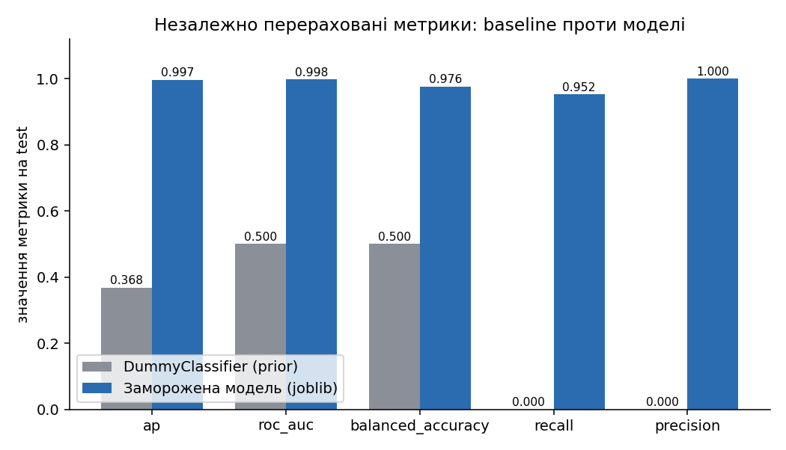
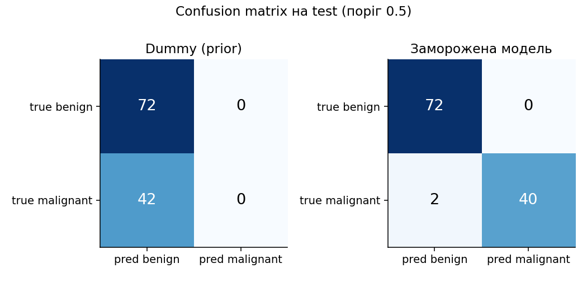
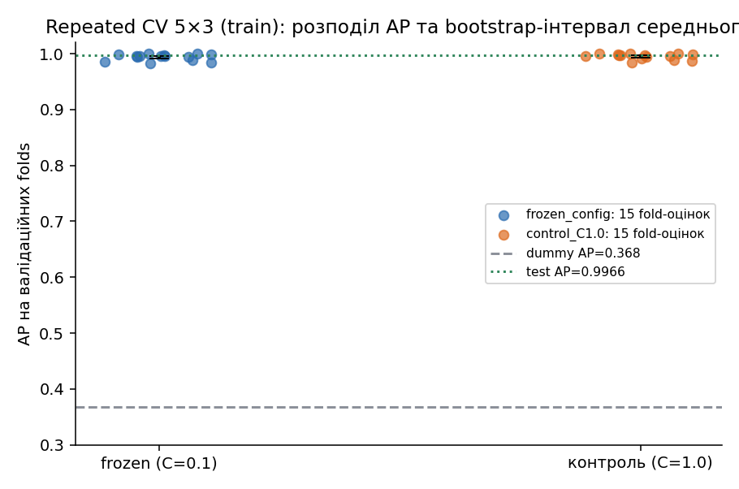
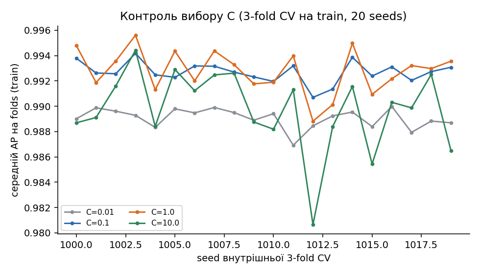
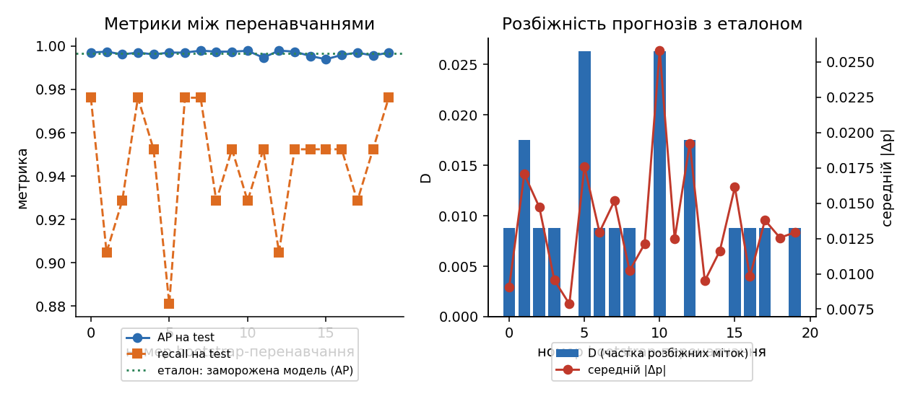
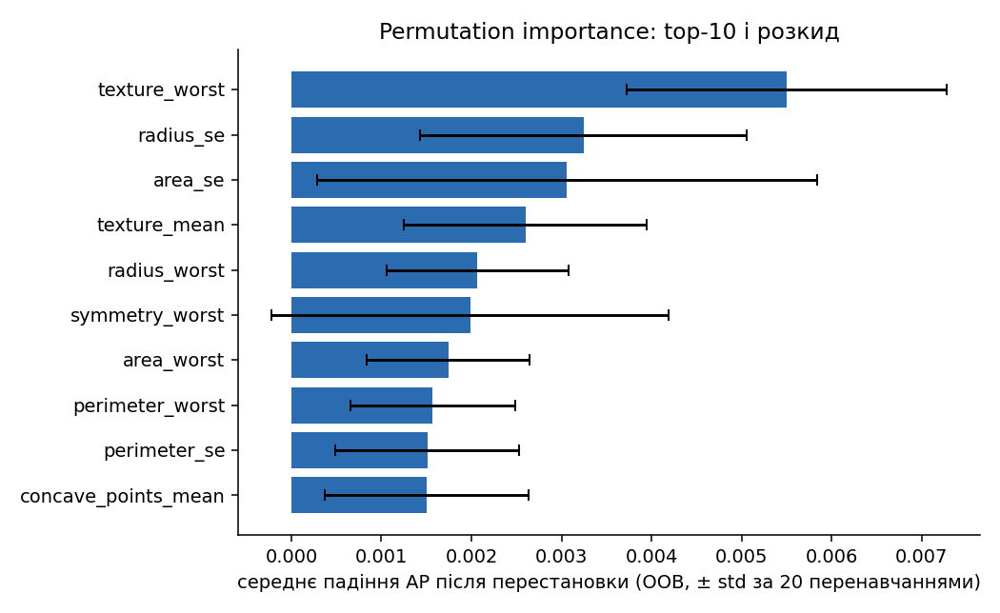
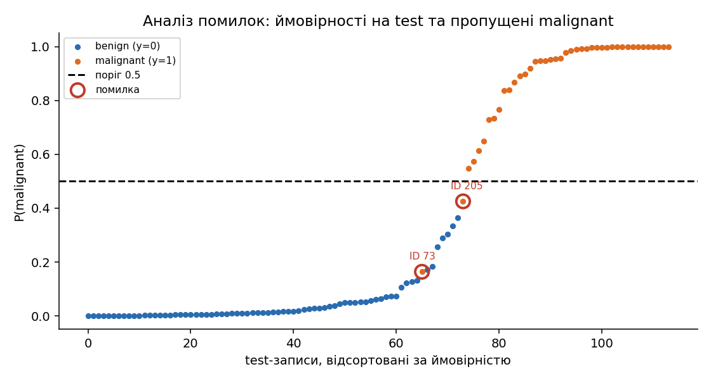
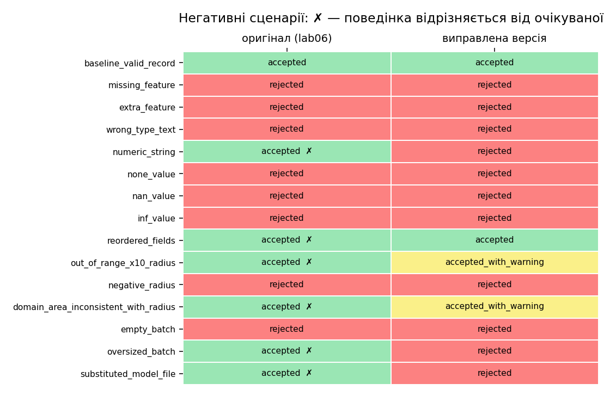

# Практична робота № 7 — Критичний аудит ML-рішення, створеного за допомогою ШІ або AutoML

**Ковальчук · група ІПЗс-24-1 · варіант 5 · викладач Бедратюк Л.П.**

Об'єкт аудиту — рішення [ЛР № 6](../lab06/) (Breast Cancer Wisconsin, AutoML FLAML проти ручного пошуку), зафіксоване на коміті
`81445e2e18764af176e48fba231ca857c412f486`; папку `lab06/` цією роботою не змінено. Окремої таблиці варіантів у методичці ПР № 7 немає:
вимога — взяти рішення ЛР № 6 або інше ШІ/AutoML-рішення. Пояснення й усі виводи — в [`notebook/practical07.ipynb`](notebook/practical07.ipynb),
журнал допомоги ШІ — в [`AI_USAGE.md`](AI_USAGE.md), машинозчитуваний вердикт — [`results/verdict.json`](results/verdict.json).
Усі числа нижче взято з файлів `results/`; позитивний клас y=1 — malignant (у `load_breast_cancer` malignant закодовано як 0, тож ціль аудиту — `1 − target`).

## 1. Тема, мета, об'єкт, межі та критерії аудиту

Мета — незалежно перевірити, які твердження ЛР № 6 підтверджуються доказами, і за яких умов результату можна довіряти; мета не в тому, щоб довести, що рішення погане.

| Параметр | Значення |
|---|---|
| Target, користувач | malignant проти benign; експерт лабораторії, який переглядає записи FNA (30 числових ознак) |
| Сценарій | ранжування записів за P(malignant) для ручного розгляду; навчальний прототип, **не діагностика**, скринінг чи тріаж |
| Основна метрика | Average Precision (AP); додаткові — ROC-AUC, balanced accuracy, F1, recall, precision, Brier, log loss, confusion matrix |
| Ціна помилок | FN (пропущений malignant) важчий за FP; поріг 0.5 фіксований у lab06, ціну формально не задано |
| Входить до аудиту | `lab06/handoff/` (модель, схема, inference, метрики, рішення), код `experiment.py`/`run_experiment.py`, README і AI_USAGE lab06, дані та split |
| Не входить | повторний model selection, клінічна валідація, нові дані, безпека за межами обробки joblib |
| Критерій прийняття | відтворення метрик із допуском 1e-9; відсутність leakage; рішення ухвалене без test; поведінка на некоректних входах визначена явно |

Протокол аудиту зафіксовано в [`configs/audit_config.json`](configs/audit_config.json) до першого запуску (допуски, кількість повторів, bootstrap, пороги). Єдина зміна
після запуску — константу 0.1 для ширини інтервалу recall винесено в конфігурацію (`finding_thresholds`) без зміни значення.

**Версія до змін.** Коміт `81445e2`; SHA-256 усіх 14 файлів handoff — у [`results/frozen_object.csv`](results/frozen_object.csv) та `artifacts/file_manifest.json`
(`pipeline.joblib`: `b63381332edb446557779d0d3042cd4e3be973cbc9fd70a1682513fe9abc315b`). Робоче дерево збігається з комітом: 4 файли байт-в-байт,
10 текстових — лише закінченнями рядків (autocrlf), 0 відмінних. Через це SHA-256 текстових файлів залежить від checkout; `decision_record.json` і `pipeline.joblib` однакові в усіх середовищах.

## 2. Інвентаризація

Усі 16 елементів [`inventory.csv`](results/inventory.csv) присутні: дані (через `sklearn.load_breast_cancer` + хеш у `data_provenance.json`), split, код навчання й запуску, конфігурація,
залежності, модель, схема входу, контрольний приклад, inference, заявлені результати, рішення з хешем, README, журнал ШІ, model card, тести. Відсутнє те, що вимагає методичка, але в пакеті не названо:
**SHA-256 моделі**, версія моделі в записі, мінімальні залежності inference (розділ 5, 14).

## 3. Реєстр тверджень

Десять тверджень ([`claims.csv`](results/claims.csv)): джерело, незалежна перевірка, критерії прийняття, доказ, рівень доказу (1–4 за методичкою) і вердикт.
Вердикт обчислює `verify_claim`: усі критерії виконано — підтверджено; частина — підтверджено частково; жодного — спростовано.

| ID | Твердження (скорочено) | Критерії | Вердикт |
|---|---|---|---|
| C-01 | test AP 0.9966, ROC-AUC 0.9977, CM [[72,0],[2,40]] | 3/3 | підтверджено |
| C-02 | test не впливав на вибір; рішення заморожене до test | 5/6 | частково (час не доведено історією git) |
| C-03 | модель узагальнює: CV 0.9942, test 0.9966 | 4/5 | частково (90 з 114 test-ID були у train ЛР5) |
| C-04 | C=0.1 і C=1.0 практично еквівалентні (\|ΔAP\|<0.01) | 2/2 | підтверджено |
| C-05 | пакет повний, цілісність гарантує SHA-256 | 2/3 | частково (хешу моделі немає) |
| C-06 | inference перевіряє контракт входу | 1/4 | частково |
| C-07 | inference потребує лише sklearn, requirements встановлюється | 2/3 | частково (повний файл падає на довгому шляху) |
| C-08 | дані: 569/212, split 455/114, дублікатів немає, хеш збігається | 5/5 | підтверджено |
| C-09 | `texture_worst` — єдина узгоджена вершина важливості | 1/2 | частково (ранги нестійкі) |
| C-10 | test використано один раз | 1/2 | частково (оцінено ще й другого фіналіста, AUDIT_ONLY) |



**Рисунок 9.** 3 підтверджено, 7 частково, 0 спростовано; знахідок 10 (0 critical, 2 high, 5 medium, 3 low). Перевага «частково» не заздалегідь визначена:
числа lab06 відтворюються, а обмеження стосуються умов застосування — контракту входу, незалежності test і цілісності пакета.

## 4. Чистий запуск

Скрипт [`clean_run.py`](clean_run.py) створює venv **поза репозиторієм**, встановлює залежності лише за наданою інструкцією й запускає `inference.py` (результат — [`clean_run.json`](results/clean_run.json); Python 3.12.0, Windows 11).

| Спроба | Шлях venv | pip exit / час | Пакетів | Запуск exit | Успіх |
|---|---|---|---|---|---|
| A: `handoff/requirements.txt`, каталог scratchpad | 122 символи | 1 / 234.2 с | 112 | 0 | ні |
| B: той самий файл, короткий шлях | 41 символ | 0 / 204.7 с | 115 | 0 | так |
| C: мінімальний `fixed/requirements.txt` | 44 символи | 0 / 60.4 с | 8 | 0 | так |

У спробі A `pip` завершився `OSError` (довгий шлях у `jupyterlab\galata\…`, підказка про Windows Long Paths), проте `inference.py` дав правильні ймовірності — numpy, scikit-learn і joblib
встановилися до збою. Тому «inference exit=0» сам по собі не доводить чистого запуску: успіх визначається трьома ознаками разом. Спроба B показує, що збій залежить від довжини шляху, а не від версій.
Приховані кроки: версія Python (3.12.0) вказана лише в `environment.json`; залежності містять `jupyter`, `flaml`, `xgboost`, `lightgbm`, яких inference не імпортує (скан об'єкта моделі: лише `numpy`, `sklearn`).

## 5. Аудит даних

[`data_audit.json`](results/data_audit.json): 569 записів, 30 ознак, 212 malignant / 357 benign; train 455 (170 malignant, 37.4%), test 114 (42, 36.8%); пропусків, від'ємних значень, сталих ознак і дублікатів рядків немає;
ID унікальні, покривають набір і не перетинаються (O_split = 0). SHA-256 сирих даних збігається з `data_provenance.json`. Назви й порядок ознак зі схеми збігаються з `load_breast_cancer`;
min/max схеми дорівнюють діапазону **train** (не всього набору); 3 значення test виходять за train-діапазон. Час доступності ознак: усі 30 — характеристики зображення FNA одного препарату, доступні до діагнозу;
ідентифікатора пацієнта й часу в `sklearn`-версії немає, тож залежність записів одного пацієнта виключити неможливо (F-07). 90 із 114 test-ID lab06 були train-ID lab05 (перерахунок за ID, збігається з `data_provenance.json`; F-05).

## 6. Leakage

[`leakage_checks.csv`](results/leakage_checks.csv), [`leakage_correlations.csv`](results/leakage_correlations.csv):

- перетин train/test ID — 0; ідентичних рядків train і test — 0; найближчий test-запис до train за стандартизованою відстанню — 0.997 (поріг «майже дублікат» 0.1: таких 0);
- найбільша \|r\| з target на train — 0.786 (`concave_points_worst`), поріг сигналу 0.9: проксі-ознак немає (кореляція лише сигнал, висновок — за походженням ознак);
- preprocessing усередині Pipeline (`SimpleImputer → StandardScaler → LogisticRegression`); `scaler.mean_` дорівнює середньому train (Δ = 0) і відрізняється від середнього всього набору (Δ = 9.99), `n_samples_seen_` = 455;
- refit тієї ж конфігурації на train дає ті самі коефіцієнти (Δ = 0) і прогнози;
- прапорці `test_used_for_search/selection` = false; у `run_experiment.py` запис `decision.sha256` (рядок 149) передує першому зверненню до `Xall[test_ids]` (рядок 152);
- правило вибору відтворено з `fold_metrics.csv`: середня різниця AP 0.001999 ≤ ε = 0.01, tie-break за розміром (2171 проти 2174 байт) → AutoML.



**Рисунок 1.** Найсильніші кореляції (до 0.79) лежать нижче порога сигналу 0.9, тож автоматичного сигналу leakage немає; вони природні для геометричних ознак (радіус, периметр, вогнутість). Рисунок не доводить відсутність leakage — його виключають структурні перевірки вище.

**Висновок.** Витоку цілі, train/test overlap за ID і preprocessing до split не знайдено. Обмеження: час freeze не підтверджується незалежним джерелом (F-08), набір повторно використаний (F-05), групових ID немає (F-07).

## 7. Фактичний протокол (схема руху даних)

| Етап | Дані | Для рішення? | Доказ |
|---|---|---|---|
| fit (imputer, scaler, LR) | train, 455 | так | `scaler.mean_` = середнє train |
| selection (family, C) | вкладена CV на train, 5×3 | так | `decision_record.json`, правило відтворено |
| threshold | не підбирався, 0.5 | ні | `config.json` |
| interpretation (permutation importance) | outer-validation train | так | lab06 README §8 |
| freeze | `decision_record.json` + `decision.sha256` | — | хеш лише рішення, не моделі |
| test, вибрана модель | 114, один раз | оцінка | `test_metrics.json` |
| test, другий фіналіст | 114, після freeze, AUDIT_ONLY | оцінка | `test_audit_other_finalist.json` |
| аудит ПР7 | test і train лише для оцінки | оцінка | жодне рішення про модель не змінено |

Усе в таблиці зведено в [`dataflow.csv`](results/dataflow.csv). Test у цій роботі використано для відтворення метрик, bootstrap-стійкості, аналізу помилок і контрольних порівнянь; ці результати не повертаються в жодне рішення про модель (ціль, test, сімейство, параметри й поріг не змінювались).

## 8. Незалежні метрики, baseline та невизначеність

Незалежний перерахунок (`evaluate_model`) на test ([`independent_metrics.csv`](results/independent_metrics.csv)):

| Модель | AP | ROC-AUC | Balanced acc. | F1 | Recall | Precision | TN/FP/FN/TP |
|---|---|---|---|---|---|---|---|
| Dummy (prior) | 0.3684 | 0.5000 | 0.5000 | 0.0000 | 0.0000 | 0.0000 | 72/0/42/0 |
| Заморожена модель (joblib) | 0.9966 | 0.9977 | 0.9762 | 0.9756 | 0.9524 | 1.0000 | 72/0/2/40 |
| Refit конфігурації на train | 0.9966 | 0.9977 | 0.9762 | 0.9756 | 0.9524 | 1.0000 | 72/0/2/40 |

Відтворення ([`reproduction_delta.csv`](results/reproduction_delta.csv)): для всіх 8 метрик і матриці помилок m = \|m_reported − m_reproduced\| = 0 (допуск 1e-9); ймовірності збігаються з `results/test_predictions.csv` (max Δp = 1.1e-16) і з `inference_example.json`.
Вимога точності виконана, тож **заявлені числа відтворюються**.



**Рисунок 2.** Baseline має AP 0.3684 (частка malignant у test), ROC-AUC й balanced accuracy 0.5 і не знаходить жодного malignant; модель перевершує його за всіма метриками.



**Рисунок 4.** Модель пропускає 2 malignant і не дає хибнопозитивних; baseline — 42 пропуски. На train (resubstitution) AP 0.9952, 2 FP і 7 FN: розрив train–test відсутній, ознак перенавчання немає.

**Repeated CV 5×3 на train** (лише train, 15 оцінок; [`repeated_cv_summary.csv`](results/repeated_cv_summary.csv)); інтервал — percentile bootstrap середнього (10 000 перевибірок), оцінки залежні:

| Метрика | Середнє | Std | Мін | Макс | 95% інтервал |
|---|---|---|---|---|---|
| AP | 0.9937 | 0.0058 | 0.9827 | 1.0000 | [0.9908; 0.9964] |
| ROC-AUC | 0.9949 | 0.0055 | 0.9840 | 1.0000 | [0.9921; 0.9973] |
| Balanced accuracy | 0.9622 | 0.0216 | 0.9265 | 1.0000 | [0.9516; 0.9729] |
| Recall | 0.9314 | 0.0426 | 0.8529 | 1.0000 | [0.9098; 0.9529] |
| Baseline AP | 0.3736 | 0.0000 | 0.3736 | 0.3736 | — |



**Рисунок 3.** Fold-оцінки AP зосереджені біля 0.994 з довгим хвостом униз (мін. 0.9827); test AP 0.9966 лежить усередині діапазону CV і вище середнього. Заявлене в lab06 значення 0.9942 відрізняється від повторної CV на 0.0004. Дані CV — контрольна оцінка, не доказ для іншої популяції.
Test-інтервали (bootstrap за об'єктами, 2000): AP [0.9864; 1.0000], ROC-AUC [0.9912; 1.0000], **recall [0.875; 1.000]** — через 42 позитиви recall визначено слабо (F-06).

## 9. AutoML і рекомендації ШІ

Параметри пошуку AutoML (search space, 12 trials, scoring AP, 5×3 вкладена CV, джерело ранжування — inner-CV train) уже зафіксовано й перевірено в lab06 (`search_contract.json`, `budget_audit.csv`); відтворювати пошук не потрібно:
переможця відновлено з `pipeline.joblib` без повторного пошуку. Для чотирьох істотних рекомендацій ШІ з `lab06/AI_USAGE.md` виконано контрольні експерименти
([`ai_recommendation_checks.csv`](results/ai_recommendation_checks.csv)):

| # | Рекомендація | Контрольний тест | Фактичний результат | Рішення |
|---|---|---|---|---|
| R-1 | tie-break за розміром pipeline обирає AutoML | парна ΔAP C=0.1 − C=1.0 на repeated CV | розміри 2171 і 2174 байт; ΔAP = −0.0014, інтервал [−0.0029; −0.0001] | прийнято: різниця ≪ ε, вибір довільний |
| R-2 | стабільність пошуку: сімейство lrl2 для 3 seeds | 20 seeds внутрішньої 3-fold CV за сіткою C ∈ {0.01, 0.1, 1, 10} | найкраще C=1.0 у 55% seeds, C=0.1 у 45% | змінено: сімейство стабільне, C — ні |
| R-3 | хеш рішення й одноразовий запуск гарантують, що test не впливав | scaler vs середнє train; refit; правило; порядок у коді; git | Δscaler(train) = 0, Δcoef = 0, правило відтворено; рішення й test-метрики в одному коміті 35ada0b | прийнято частково: протокол train-only, час не доведено |
| R-4 | закріпити flaml/xgboost/lightgbm; inference потребує лише sklearn | чисті venv, скан моделі | модель використовує `numpy`, `sklearn`; повний файл: A — збій, B — успіх; мінімальний набір — успіх | змінено: мінімальний набір для inference |



**Рисунок 10.** Лінії C=0.1 і C=1.0 майже збігаються, а мінімальна різниця змінює знак між seeds, тому «оптимальний C» у цих даних невизначений. Різниця ΔAP = −0.0014 систематична на repeated CV (інтервал не містить 0), але в 7 разів менша за ε; формулювання lab06 про довільність tie-break доказово чесне.

## 10. Стійкість

20 bootstrap-перенавчань фіксованої конфігурації (вибірка з поверненням розміру train, [`stability_runs.csv`](results/stability_runs.csv)); порівняння з заморожною моделлю на test:

| Показник | Середнє | Мін | Макс |
|---|---|---|---|
| AP | 0.9967 (std 0.0011) | 0.9940 | 0.9979 |
| Recall | 0.9452 | 0.8810 | 0.9762 |
| Розбіжність міток D | 0.0088 | 0.0000 | 0.0263 (3 з 114) |
| Середній \|Δp\| | 0.0135 | 0.0079 | 0.0258 |
| Макс. \|Δp\| для одного об'єкта | 0.1322 | 0.0781 | 0.2558 |



**Рисунок 5.** AP майже не змінюється, але recall коливається від 0.881 до 0.976 (1–5 пропущених malignant), а мітка змінювалась щонайменше в одному перенавчанні для 5 test-об'єктів (найбільше 30% перенавчань — ID 205). Стабільна середня метрика не гарантує стабільності конкретних прогнозів; нестійкі саме об'єкти поблизу порога.

**Permutation importance** (AP, на OOB-вибірках train кожного перенавчання, 5 перестановок; [`importance_summary.csv`](results/importance_summary.csv)). Найвище — `texture_worst` (падіння AP 0.0055 ± 0.0018; перша в 75% повторів, у top-5 — у 100%),
далі `radius_se` (0.0032), `area_se` (0.0031), `texture_mean` (0.0026), `radius_worst` (0.0021). Узгодженість рангів між повторами: Spearman 0.601, середній top-5 Jaccard 0.353.



**Рисунок 6.** Лише перше місце порівняно стійке; планки розкиду нижчих ознак перекриваються (в `symmetry_worst` — перетинають 0). Корельовані геометричні ознаки ділять важливість, а перестановка однієї з них створює нереалістичні комбінації.
Тому твердження C-09 підтверджене лише частково: «найчастіше перша» — так, «єдина узгоджена вершина без решти порядку» — ні. Це чутливість конкретної моделі до перестановки, **не причинний вплив**; причинного дизайну немає.

## 11. Аналіз помилок

[`error_objects.csv`](results/error_objects.csv): 11 об'єктів — усі 2 помилки test, 5 найближчих до порога, 3 найнестійкіші між перенавчаннями (частково збігаються), 5 найупевненіших помилок OOF-прогнозів repeated CV на train.

| Набір | ID | y | p | Тип | Примітка |
|---|---|---|---|---|---|
| test | 73 | 1 | 0.164 | FN | упевнена помилка; C=1.0 теж пропускає; стабільна |
| test | 205 | 1 | 0.425 | FN | біля порога; мітка змінюється у 30% перенавчань |
| test | 99, 385, 86 | 1 | 0.548, 0.573, 0.613 | вірні | зона порога, зміна мітки 20/25/15% |
| test | 455 | 0 | 0.365 | вірний | зона порога; C=1.0 класифікує помилково |
| train OOF | 38, 40, 135, 263, 297 | 1 | 0.280, 0.167, 0.153, 0.257, 0.019 | FN | ID 297 — p = 0.019, найупевненіший пропуск |



**Рисунок 7.** Обидва пропущені на test записи лежать у «хвості» ймовірностей malignant нижче порога 0.5. Усі помилки — FN; жодного FP на test, а в OOF train FN теж домінують (у 5 найупевненіших). Агрегований AP 0.9966 приховує саме цей тип помилки — пропущений malignant,
який важчий за хибну тривогу. Baseline цих записів теж не знаходить; значення поза train-діапазоном у проаналізованих об'єктах немає (0 ознак). Помилки не спільні для всіх контрольних моделей: ID 73 пропускає і контроль C=1.0, ID 38 — лише заморожена модель.

## 12. Інтерпретація

Метод — permutation importance за AP на OOB-даних; дані обчислення — train-частини, що не потрапили у bootstrap; стабільність — розділ 10; кореляції — розділ 6. Причинні формулювання не виправляються в коді, бо lab06 їх не містить
(у README прямо сказано «не причинний вплив»), але наш аудит додає: важливість не доводить, що зміна `texture_worst` змінить діагноз; модель нестійко ранжує ознаки (Jaccard 0.353).

## 13. Негативні сценарії й програмні ризики

15 сценаріїв ([`negative_tests.csv`](results/negative_tests.csv)): оригінальний `lab06/handoff/inference.py` (позиційний масив) і виправлений `fixed/serving.py` (записи з іменами ознак). Очікування — до запуску.

| Сценарій | Очікування | Оригінал | Виправлена |
|---|---|---|---|
| коректний запис | accepted | accepted | accepted |
| відсутня / зайва ознака, текст, None, NaN, inf, від'ємний радіус, порожній batch | rejected | rejected | rejected |
| числові рядки (`"16.02"`) | rejected | **accepted** (мовчки перетворено) | rejected |
| інший порядок полів | accepted, той самий p | **accepted, p = 0.7259 замість 0.7169** | accepted, p = 0.7169 |
| radius_mean ×10 | accepted_with_warning | **accepted** (p = 1.0) | accepted_with_warning |
| area_mean = 2000 при radius_mean = 10 (площа в 6.4 раза більша за π·r²) | accepted_with_warning | **accepted** (p = 0.817) | accepted_with_warning |
| batch 10 001 запис | rejected | **accepted** | rejected |
| підмінений файл моделі (інша валідна модель C=10) | rejected | **accepted** (p = 0.9978) | rejected (IntegrityError) |

Оригінал відповідає очікуванням у 9 із 15 (шість сценаріїв не відповідають: числові рядки, порядок, діапазон, геометрія, batch, підміна), виправлена версія — у 15 із 15. 

**Рисунок 8.** Оригінал надійно відхиляє технічно некоректні числа (NaN, inf, від'ємні, форма), але не контролює ні імена й порядок, ні діапазон, ні предметну узгодженість, ні цілісність файла. Warning відрізняється від rejection:
значення поза діапазоном і геометрична неузгодженість не робить запис недійсним, але ймовірність у такому режимі не можна вважати надійно каліброваною; рішення — повернути статус і текст попередження (політику описано в `fixed/data_schema.json`).
Програмні ризики: `joblib.load` виконує код при завантаженні, тож модель без контрольної суми не можна вважати довіреною (F-01); жорстко заданих локальних шляхів і секретів в `handoff/` не знайдено; логування сирих ознак немає; помилки обробляються лише загальними `ValueError`.

## 14. Реєстр знахідок

Десять знахідок ([`findings.csv`](results/findings.csv)); критичність — за наслідком, а не за складністю виправлення. Знахідки створюються лише за виконаної умови (їх не придумано): наприклад, F-01 з'являється, лише якщо SHA-256 моделі справді не знайдено в пакеті.

| ID | Критичність | Проблема й доказ | Статус |
|---|---|---|---|
| F-01 | high | Немає контрольної суми `pipeline.joblib`; `decision.sha256` охоплює лише рішення; підмінена модель C=10 завантажується без помилки (p = 0.9978) | виправлено (`fixed/pipeline.sha256`, перевірка до `joblib.load`) |
| F-02 | high | Позиційний масив без імен: переставлені колонки дають p = 0.7259 замість 0.7169 без попередження | виправлено (записи з іменами) |
| F-03 | medium | Немає warning для значень поза train-діапазоном і для неузгодженості площі/радіуса | виправлено (`accepted_with_warning`) |
| F-04 | medium | Повний `requirements.txt` (115 пакетів) падає на довгому шляху; inference потребує 5 | виправлено (мінімальний файл, 8 пакетів, 60 с замість 205 с) |
| F-05 | medium | 90 із 114 test-ID були у train ЛР5: test не «свіжий» щодо курсу | прийнятий ризик |
| F-06 | medium | 42 позитивні в test: recall 0.952 має інтервал [0.875; 1.000]; 2 FN | прийнятий ризик |
| F-07 | medium | Немає patient/group ID і часу: залежність записів не виключена | прийнятий ризик |
| F-08 | low | Порядок «freeze → test» не підтверджується git: рішення, модель і test-метрики востаннє змінені в коміті `35ada0b` | задокументовано |
| F-09 | low | «Test використано один раз» неточне: другого фіналіста теж оцінено (AUDIT_ONLY) | задокументовано |
| F-10 | low | C=0.1 практично довільний (45% проти 55% seeds; ΔAP = −0.0014, ≪ ε) | задокументовано |

Критичних знахідок немає: leakage, вибір за test і розбіжність відтворених метрик не виявлено.

## 15. Виправлена версія

Папка [`fixed/`](fixed/) виправляє чотири знахідки (F-01…F-04) **без зміни** цілі, test, сімейства, параметрів і порогу: `pipeline.joblib` скопійовано байт-в-байт (SHA-256 збігається з оригіналом), `pipeline.sha256`
додано; [`serving.py`](fixed/serving.py) перевіряє суму до розпакування, приймає записи з іменами (порядок не має значення), відхиляє відсутні/зайві поля, нечислові типи, NaN, inf, від'ємні значення й надмірний batch,
повертає warning за виходу за діапазон і геометричної неузгодженості (допуск 0.15 вибрано за максимальним відхиленням 0.083 для «mean»-ознак на даних) та стабільний формат відповіді; `requirements.txt` — мінімальний.
Повторна оцінка ([`fixed_evaluation.json`](results/fixed_evaluation.json)): 114 test-записів із випадковим порядком ключів — max \|Δp\| = 0, мітки й усі метрики ідентичні, CM [[72,0],[2,40]];
111 записів `accepted`, 3 — `accepted_with_warning` (значення поза train-діапазоном), прогноз для них не змінено. Виправлена версія не покращує якість — вона захищає контракт.

## 16. Тести

`python -m unittest discover -s tests -v` — **54 тести, усі OK** (≈20 с): 26 модульних тестів `audit_core`/`serving` (overlap, кореляції, метрики, baseline, bootstrap, розбіжність, стійкість рангів, вибір помилок, `verify_claim`, `build_finding`, правило вердикту, `validate_record` для відхилень і попереджень, контрольна сума),
6 тестів git-походження на тимчасових репозиторіях і 22 інтеграційні тести артефактів: комплектність файлів, формат і узгодженість claims/findings/verdict, відтворення метрик, split, контрольний прогноз із збереженої моделі, CM ↔ список помилок,
інтервали містять середнє, SHA-256 маніфесту, ідентичність прогнозів виправленої версії. Регресійні тести проєкту (розділ 18) спочатку завершувалися помилкою на попередньому коді (`AI_USAGE.md`).

## 17. Вердикт

**Потребує доопрацювання** (початкове рішення lab06; [`verdict.json`](results/verdict.json)). Підстава: 2 високі знахідки (F-01, F-02) — упаковане рішення не захищає модель від підміни й мовчки видає хибний прогноз на переставлених ознаках, —
плюс твердження C-05, C-06, C-07 підтверджені лише частково. Науковий результат lab06 заперечувати нема чого: метрики відтворюються до машинної точності (C-01), leakage немає (C-08, розділ 6), baseline перевершено (AP 0.9966 проти 0.3684),
CV, test і стійкість узгоджені. Після виправлень F-01…F-04 лишаються 3 середні й 3 низькі знахідки, тож виправлена версія — **прийнято з обмеженнями**: лише навчальне ранжування записів експертом,
не діагностика; test не незалежний від курсу (F-05), мала вибірка для recall (F-06), групових ID немає (F-07), вибір C довільний (F-10). Вердикт стосується початкового рішення; виправлений код — доказ того, що високі знахідки усуваються, а не схвалення клінічного застосування.
Правило вердикту закодовано в `decide_verdict` (critical → відхилено; high → доопрацювання; medium/low → з обмеженнями) і перевіряється тестом.

## 18. Відтворення

```bash
python -m venv .venv
# Windows: .venv\Scripts\activate
pip install -r fixed/requirements.txt
pip install pandas matplotlib nbformat jupyter    # лише для аудиту й notebook, inference їх не потребує
python pr07_audit.py                              # ≈ 75-120 с; результати, рисунки, fixed/, artifacts/file_manifest.json
python -m unittest discover -s tests -v
python clean_run.py <довгий_каталог> <короткий_каталог>   # необов'язково, ≈ 10+ хв, мережа; пише results/clean_run.json
python build_notebook.py
jupyter nbconvert --to notebook --execute --inplace notebook/practical07.ipynb
python fixed/serving.py                           # демонстрація виправленого inference
```

Python 3.12.0, scikit-learn 1.9.0, numpy 2.2.3, pandas 3.0.5. Команди запускаються з `practical07/`; `lab06/` лише читається. Дані завантажуються через `sklearn.datasets.load_breast_cancer`, копій не зберігається.
Часи встановлення й довжина шляху залежать від машини; метрики детерміновані за фіксованих версій. Word/PDF і окремі контрольні питання до пакета не включено.

| Файл | Роль |
|---|---|
| [`audit_core.py`](audit_core.py) | незалежні функції: overlap, кореляції, метрики, bootstrap, розбіжність, `verify_claim`, `build_finding`, вердикт, git-походження |
| [`pr07_audit.py`](pr07_audit.py) | повний аудит → `results/`, `figures/`, `fixed/`, маніфест |
| [`clean_run.py`](clean_run.py), [`build_fixed.py`](build_fixed.py) | чистий запуск у venv; побудова виправленої версії |
| [`configs/audit_config.json`](configs/audit_config.json) | зафіксований протокол |
| [`fixed/`](fixed/) | виправлена версія (serving, checksum, схема v2, мінімальні залежності) |
| [`tests/`](tests/) | 54 тести |

## 19. Обмеження аудиту

Аудит не має доступу до іншого джерела часу, ніж git; не перевіряє клінічну придатність; контрольні порівняння (C=1.0) використовують test лише для аналізу помилок, не для вибору. Фактичні 15 негативних сценаріїв — вибірка, не повний перелік.
Оцінки на 15 folds і 20 bootstrap-повторах залежні. Перелік `Знахідки` не претендує на повноту.
